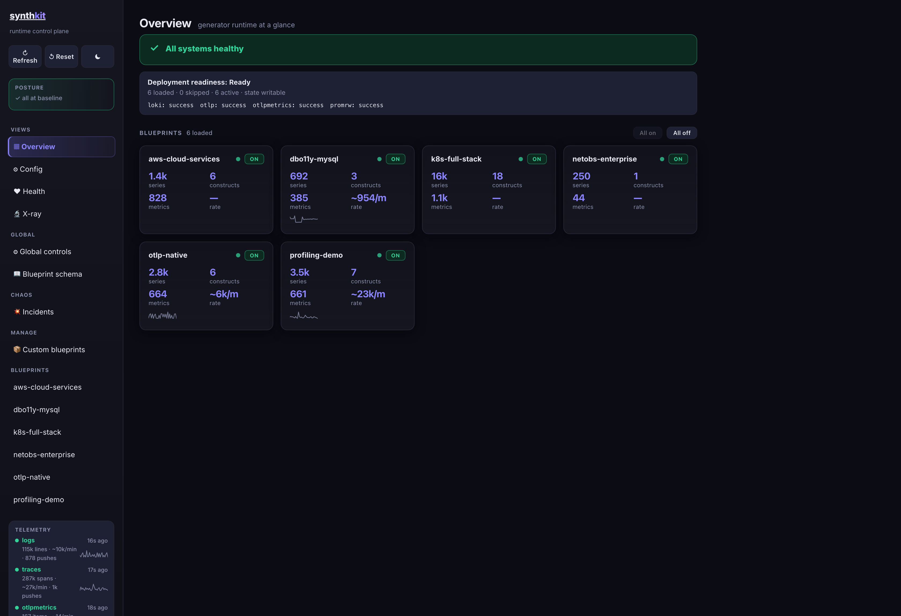
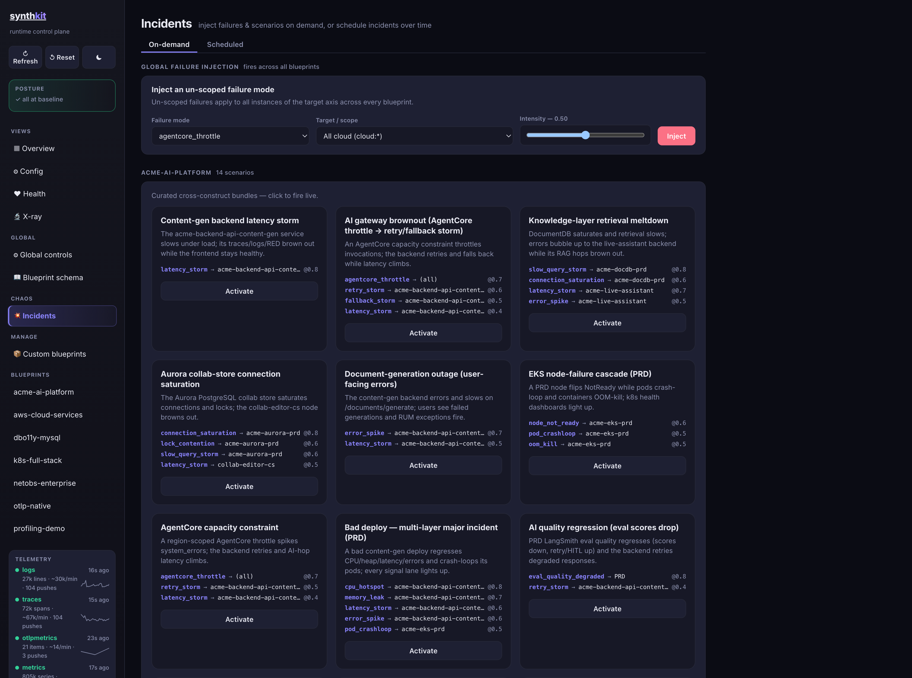
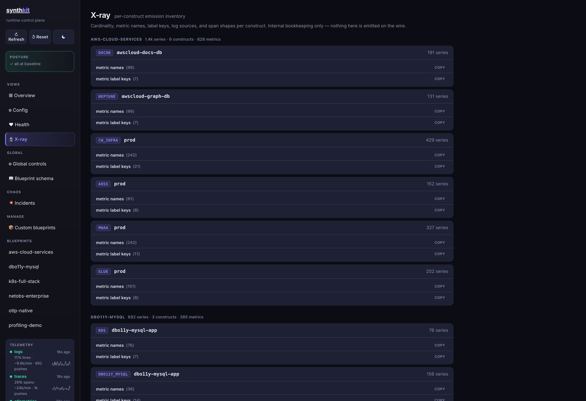

# synthkit

[](https://scorecard.dev/viewer/?uri=github.com/rknightion/synthkit)

**Get a realistic, Grafana-visible metrics, logs, and traces environment from one YAML blueprint — without deploying a real application.**

**[Documentation](https://m7kni.io/synthkit/)** — installation, blueprint reference and the signal catalog.

Composable synthetic-telemetry generator for Grafana Cloud. Declare a model of the infrastructure
and applications you want in one YAML **blueprint** — synthkit does not deploy those applications
or infrastructure — and it emits structurally-correct
synthetic metrics, traces, and logs (plus optional Faro/RUM) with the REAL metric/label/field
names of each technology it models: EKS + the k8s-monitoring substrate, EC2/ALB/NAT-gateway/EBS/
S3 CloudWatch families, RDS/ElastiCache, Database Observability (MySQL/Postgres), Azure/GCP CSP,
Cloudflare, Synthetic Monitoring, Fleet Management, and correlated request workloads — `web_service`
(a single service) and `app` (a declared multi-service GRAPH whose nodes emit custom metrics/logs/
spans via a telemetry DSL) — sharing one end-to-end correlation ID per request across the graph.

- **Catalog**: isolated construct/workload modules, each with a verified signal contract
  ([SIGNALS.md](./SIGNALS.md)).
- **Composition**: a blueprint is one deletable YAML file; constructs know nothing about it.
  See [ARCHITECTURE.md](./ARCHITECTURE.md).

## The runtime control plane

Every deployment serves an operator UI at `/control/ui` — live per-blueprint emission rates, a
per-construct cardinality inventory, and on-demand failure injection.



Curated incident scenarios fire correlated failures across constructs — a bad deploy, a node-failure
cascade, a retrieval meltdown — so a dashboard or alert can be demonstrated against a real signal.



The X-ray view accounts for every series before it leaves the process: metric names, label keys and
cardinality per construct.



## Start here

Start with Git, a running Docker Engine with Compose, a shell and a browser:

```bash
git clone https://github.com/rknightion/synthkit.git
cd synthkit
```

Follow the **[Docker Quick Start](docs/quickstart.md)** to create local configuration, prepare private
storage, preview the `otlp-native` blueprint without credentials, then connect Grafana Cloud and
verify fresh metrics, logs and traces. The current stable image includes the operator UI and
dashboard generator. You do not need Go, Node.js, `just`, `gcx` or an AI assistant for this path.

The [dashboard tools guide](docs/tools.md#synthkit-dash-grafana-dashboard-generator) covers optional
Docker-contained exports. The [installation guide](docs/installation.md) covers source builds;
the [deployment guide](docs/deployment.md#container-image) records the default image's release,
digest and provenance.

For a repeatable native-app demonstration, use the **[stock demo folder](quickstart/README.md)**.
It selects the shipped HTTP and MySQL examples, reads private credentials from its local `.env`,
and includes a short terminal-to-Grafana [presenter walkthrough](quickstart/demo.md).

For other starting points:

- [Understand the model](docs/getting-started.md) — blueprints, workloads and signal destinations.
- [Write a blueprint](docs/blueprints.md) — adapt an existing example.
- [Contribute](docs/contributing.md) — developer setup, agent workflows and required checks.

## LLM-assisted setup (Claude Code / Codex / OpenCode)

synthkit ships optional agent skills for deployment and operation. The bundled documentation is
sufficient for setup; no external documentation-query plugin is required. In **Claude Code**, open this repo and enter
`/initial-setup` (also `/verify-deployment`, `/create-blueprint`,
`/setup-fleet-management`) in the chat input. To install as a plugin from anywhere, enter these in
Claude Code chat; they are not shell commands:

    /plugin marketplace add rknightion/synthkit
    /plugin install synthkit@synthkit      # → /synthkit:initial-setup, etc.

The same skills work in **Codex** (`.agents/skills/`) and **OpenCode** (reads `.claude/skills/`).
Skills are authored once under `plugins/synthkit/skills/`; `.claude/skills` and `.agents/skills` are
symlinks kept in sync by `just skills-sync` (verified by `just skills-check`).

## Customise the demo

A blueprint declares a model of the infrastructure and applications you want to observe. It does
not deploy pods, databases or application code. Select exact blueprint names with `BLUEPRINT_NAMES`;
an empty selection starts setup mode without synthetic emission, and `*` explicitly selects the
available catalogue.

Published containers carry their own bundled YAML. Editing a blueprint in the checkout does not
change the running image. Use the operator UI's upload or Git-source flow in
[Custom Blueprints](docs/custom-blueprints.md), then select the effective namespaced name and
follow its apply/restart rules. The default Compose file does not mount host blueprint files.
Source development can change the bundled set before building a new image.

The [blueprint guide](docs/blueprints.md) explains composition and validation. The
[generated schema](BLUEPRINT-SCHEMA.md) and [signal catalogue](SIGNALS.md) define the supported
configuration and emitted data.

## Run incident demos

Named scenarios apply related failures across declared constructs so dashboards and alerts can
be rehearsed against correlated signals. Use the operator UI to activate and clear a supported
scenario; [Incidents and scenarios](docs/incidents.md) explains targets, effects and scheduling.
A modelled topology does not establish vendor telemetry coverage for every component.

The [control plane](docs/control-plane.md) exposes live volume controls, workload scaling,
incident activation and per-construct inventory. The local Docker walkthrough serves the UI at
[http://127.0.0.1:8088/control/ui](http://127.0.0.1:8088/control/ui). Keep its loopback default for a
workstation demo; use the deployment guide for shared access and authentication.

## Optional Grafana control-plane integrations

Synthetic Monitoring and Fleet Management have their own credentials and explicit setup paths.
They are separate from sending metrics, logs and traces. Synthetic Monitoring uses a previewed,
version-matched one-shot provisioner and an apply/restart handoff; ordinary dry-run is not
permission to change remote resources. Follow [Synthetic Monitoring](docs/synthetic-monitoring.md)
and [Fleet Management](docs/fleet-management.md) when choosing those integrations.

## Capabilities and support

See the [construct catalogue](docs/constructs.md), [workloads](docs/workloads.md) and
[signal contracts](SIGNALS.md) for supported telemetry. Vendor-specific gaps are recorded in
[cantfind.md](cantfind.md); implementation work is tracked in [GitHub issues](https://github.com/rknightion/synthkit/issues).
A modelled topology does not imply that every vendor telemetry profile is available.

The [verification runbook](docs/RUNBOOK.md) explains how to prove delivery in your own stack.
Passing a local dry run or a historical deployment test does not establish current live delivery.

## License

`synthkit` is licensed under the GNU Affero General Public License v3.0 only (`AGPL-3.0-only`).
See [LICENSE](./LICENSE) and [LICENSING.md](./LICENSING.md). Every Go source file carries an
`SPDX-License-Identifier: AGPL-3.0-only` header.
