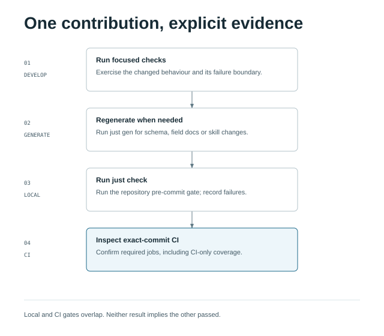

# Contributing

You can contribute blueprints, signal fidelity improvements, code, or documentation. To run synthkit
without changing it, use [Getting started](getting-started.md). This page covers a development
checkout; the [contribution policy](https://github.com/rknightion/synthkit/blob/main/CONTRIBUTING.md) covers submission and licensing.

## Prepare a development checkout

Fork and clone the repository, then work on a topic branch. The local gate needs more than the Go
compiler:

| Tool | Required for |
|---|---|
| Git | Checkout and tracked-file checks; the supported clean-host baseline is 2.39+ |
| Go 1.27+ | Match `go.mod`; compile, test, vet, and generate schemas |
| A C compiler supported by Go | The race detector, even though the production binary is built without CGO |
| Node.js 24 and npm | Match the CI UI toolchain; install the lockfile and build/test embedded UI assets |
| Bash 5+ and `just` 1.58.0+ | Repository recipes and helper checks; ensure the intended Bash is on `PATH` |
| Python 3.11+ | Documentation and deployment-helper validation |
| Helm | Chart render checks; versions 3.19.0, 3.20.0, and 4.3.0 have been locally verified |
| `jq`, Mike Farah `yq` v4, and `rg` (ripgrep) | JSON/YAML and capture-lab scaffold validation |
| Docker CLI with Compose 2.24.4+ | Local Compose rendering; Docker Engine 24+ is needed for daemon-backed checks |
| Standard shell utilities and `curl` | Helper checks and local HTTP fixtures |

These are the current repository requirements, not a second set of tool pins. Check `go.mod`,
`justfile`, the UI lockfile, and `.github/workflows/ci.yml` when changing tool versions. No Grafana
credential or paid review account is required for the portable local gate. Module/package downloads
need network access; tests exercise local fixtures and fake services.

```bash
just setup </dev/null
just build </dev/null
```

`setup` installs module/UI dependencies. The `lint` recipe runs `go vet`; no unused linter
installation is required. Run `just ui` before building a binary whose operator UI you will use. You do not need to configure
a live `.env` to contribute. Preserve any existing `.env` and never commit credentials.

## Work in a focused loop

Read [the architecture contract](https://github.com/rknightion/synthkit/blob/main/ARCHITECTURE.md) before changing tiers, the runner, or sinks.
Constructs and workloads stay isolated; blueprints own composition. Read the relevant
[signal catalogue](signals.md) before changing emitted names, labels, types, or units. Source missing
facts from observed data or vendor documentation and retain provenance. An unsupported signal stays
a documented gap rather than an invented output.

Use the smallest check that exercises your change, for example:

```bash
just test-packages ./internal/fixture </dev/null
just ui-check </dev/null
just docs-check </dev/null
```

For a bug fix, first observe the reproduction fail for the intended reason. For new behavior, test
meaningful public boundaries and failure cases. Documentation, comments, and pure wiring should use
appropriate validation rather than tests that only repeat the implementation. Do not weaken a test
or rewrite a captured baseline merely to make the change pass.

## Update derived artifacts and evidence

- Blueprint schema or config-type changes: run `just gen`, review the generated diff, and verify
  `just gen-check`. Do not edit generated schema output by hand.
- Skill changes: edit the canonical files under `plugins/synthkit/skills/`; `just skills-sync`
  maintains the harness symlinks and `just skills-check` verifies them.
- Telemetry renderer changes: run `just dump` with an explicit `DUMP_BLUEPRINTS` selection and compare
  the emitted series/labels against the relevant `signals/` contract. Use `just signals-conformance`
  on the retained dump. Registration-gated families need a controlled registered fixture; an empty
  dump does not prove their fidelity. Keep deployment and vendor evidence distinct from offline tests.
- Documentation changes: update the relevant page and navigation together. `just docs-check`
  validates the docs navigation and local links; it does not prove prose correctness, command
  behavior, external links, or rendered diagrams. Inspect those separately.

The [blueprint authoring skill](https://github.com/rknightion/synthkit/blob/main/plugins/synthkit/skills/create-blueprint/SKILL.md) covers composition
within the existing catalogue. Adding a construct or a new signal contract is code contribution work.

## Finish with the right gates

<div class="diagram-scroll" markdown>



</div>

[Open the diagram at full size](assets/diagrams/contributor-checks.html).

```bash
just check </dev/null
# Additional daemon-backed checks, with Docker running:
just ci </dev/null
```

`just check` is the pre-commit gate. Its dependencies in the `justfile` are authoritative; do not
maintain a copied checklist of every recipe. It includes the full plain Go suite and a slow race
suite. The race recipe deliberately excludes `internal/integration` for runner memory limits;
that package is still covered by the plain suite. The race recipe also splits out the
timing-sensitive tests listed in `scripts/race-isolated.txt`: the parallel sweep skips them and
they run once afterwards in their own `go test -race -v` invocation, because their bounds can miss
under contention from the sweep. They are the HA subprocess tests, with sub-second lease and
renewal bounds, and the Agent Observability lifecycle engine tests, with 4 s and 20 s caller
budgets, which probe those budgets and log a `deadline-margin` line after each engine return.
To isolate another package's tests, add lines to that file; `just race-split-check` (part of
`just check`) proves each listed test runs exactly once and that every test whose own body
calls the deadline-margin probe is listed (a test reaching the probe only through a helper is
not detected, so list it by hand). Run focused checks while iterating and the full gate on the
final candidate. Read the repository agent instructions for change-specific slow tiers,
such as the disposable collector capture lab.

`just ci` adds Docker-backed checks and a full-history secret scan, so it requires a full-depth
checkout and a working daemon. It is not an exact reproduction of hosted CI: GitHub also runs
Kubernetes schema validation through shared workflows, while some local acceptance recipes are
not part of its main CI workflow. Consult `.github/workflows/ci.yml` for the hosted job set and
required result. A local pass does not replace CI on the submitted commit, and CI is not proof of
live Grafana delivery.

If a gate cannot run, report the command, reason, and checks that did run. A maintainer may agree to
an explicit CI-first exception; never infer one or report an omitted local check as passed. Do not
change timeouts, exclusions, or fixtures just to obtain a green result.

## Agent and human review

Agents use the bundled [contribute skill](https://github.com/rknightion/synthkit/blob/main/plugins/synthkit/skills/contribute/SKILL.md), which routes
to this guide and the same recipes. The repository agent instructions define when specialist skills
apply. Skill usage alone is not evidence: include actual command outcomes and remaining gaps.

Public contributors submit a focused pull request and use the project's hosted checks and review
process. Maintainers also use CodeRabbit CLI review under their own configured policy; contributors
are not required to obtain a personal paid CLI account or reproduce private maintainer tooling.
Do not upload credentials or customer identifiers to any review service. Review and correct the
final diff before reporting completion, and use the PR template to summarize the evidence.

Live deployment, provisioning, and telemetry destination changes are separate operations. In
particular, recipes with confirmation prompts must not be made unattended by passing `--yes`.
