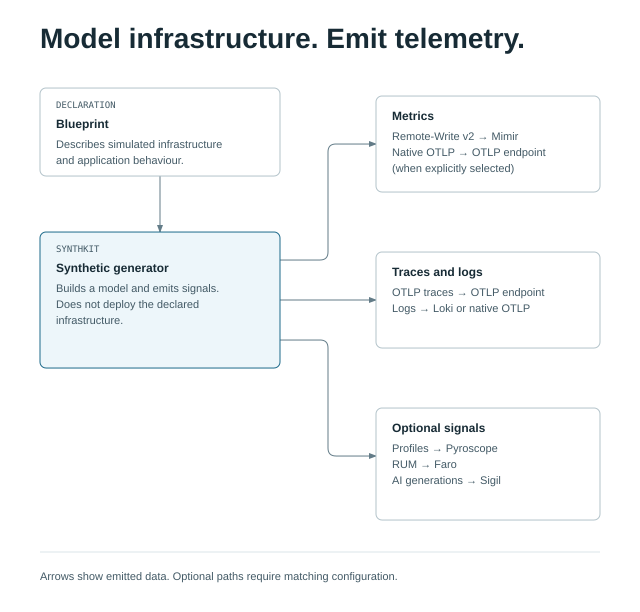

# synthkit

synthkit gives you a Grafana-visible synthetic environment: run a bundled blueprint and see realistic metrics, traces, and logs arrive in your stack. It models the infrastructure and applications you declare; it does **not** deploy them. From that YAML **blueprint**, synthkit emits structurally-correct synthetic metrics (Prometheus Remote-Write v2), traces (OTLP), logs (Loki), and optional RUM (Faro) using the **real** technology-native metric/label/field names of each technology it models. No invented names, no placeholder shapes. Signal contracts and their verification status are recorded in the [`signals/`](https://github.com/rknightion/synthkit/blob/main/SIGNALS.md) catalogue.

Use synthkit to build and validate dashboards and alerts against realistic data, generate demo environments, or run observability training without touching a production system.

-   :material-rocket-launch: **Try synthkit**

    ---

    Start without credentials, then opt into live delivery and verify it.

    [:octicons-arrow-right-24: Quick Start](quickstart.md)

-   :material-file-document-edit: **Writing blueprints**

    ---

    Declare environments, clusters, databases, workloads, and incident scenarios.

    [:octicons-arrow-right-24: Blueprints overview](blueprints.md)

-   :material-book-open-variant: **Signal catalogue**

    ---

    Metric families, label sets and fields, with source provenance and verification status.

    [:octicons-arrow-right-24: Reading the catalogue](signals.md)

-   :material-floor-plan: **Architecture**

    ---

    Three-tier design, frozen seams, invariants, and composition model.

    [:octicons-arrow-right-24: Architecture](architecture.md)

## Start with one blueprint

The [Quick Start](quickstart.md) is the canonical first-run walkthrough. It builds the binary and
operator UI, previews the `otlp-native` blueprint without synthetic delivery, then takes you through
credentials, preflight and live read-back. No Grafana credentials are needed for the preview.

[Open the diagram at full size](assets/diagrams/telemetry-flow.html).

Choose [Installation](installation.md) for a prebuilt container, [Getting Started](getting-started.md)
for the concepts, or [Contributing](contributing.md) to change the project.

## What synthkit emits

| Signal type | Protocol | Destination |
|---|---|---|
| Metrics | Prometheus Remote-Write v2 or native OTLP | Grafana Cloud Mimir |
| Traces | OTLP (hand-encoded ResourceSpans) | Grafana Cloud Tempo |
| Logs | Loki push or native OTLP | Grafana Cloud Loki |
| RUM (optional) | Faro collector | Grafana Cloud Frontend Observability |
| Profiles (optional) | Pyroscope | Grafana Cloud Profiles |

Metrics, traces, logs and synthetic profiles can share a Cloud Access Policy token, with destination-specific endpoints and user IDs. Faro uses its own collector/application-key pair. Optional Sigil generation ingest and the generator’s own self-observability have separate credentials. See [Credentials](credentials.md).

## The blueprint model

A **blueprint** is a single YAML file that wires together construct and workload instances with config. Constructs are isolated modules — each emits the real signal names of one technology (EKS, RDS, Cloudflare, Fleet Management, and so on). Workloads generate correlated request traffic: `web_service` models a single service with a browser→backend→DB hop tree; `app` models a multi-service graph whose nodes emit custom telemetry via a DSL. They model traffic and telemetry only; synthkit does not deploy a real app. Constructs know nothing about blueprints or each other; deleting a blueprint file removes its telemetry and affects nothing else.

`DRY_RUN` defaults to `true`, and empty `BLUEPRINT_NAMES` selects nothing. Live pushing and the
blueprint set are both explicit opt-ins; use `BLUEPRINT_NAMES=*` only for the complete catalog.

## Principles

- **No invented names.** Every metric, label, and field name is sourced from the `signals/` catalogue, which records vendor evidence, observed captures and explicit modeling assumptions.
- **Isolated constructs.** Constructs and workloads never import each other, the blueprint package, or any OTel SDK. Zero coupling flows backward.
- **One blueprint = one file.** Config lives in the blueprint; constructs are unconditional. Add a scenario, remove an environment, or delete the whole blueprint — nothing else changes.
- **Deterministic.** The same blueprint produces the same identities (pod names, node IDs, instance keys) on every run. Fixtures are seeded from the blueprint name and path, not from process time.
- **Cumulative correctness.** Counters and histograms accumulate across ticks; the sink receives running totals, not deltas, matching how real exporters work.

## License

synthkit is licensed under the [GNU Affero General Public License v3.0 only (`AGPL-3.0-only`)](https://github.com/rknightion/synthkit/blob/main/LICENSE). Every Go source file carries an `SPDX-License-Identifier: AGPL-3.0-only` header.
