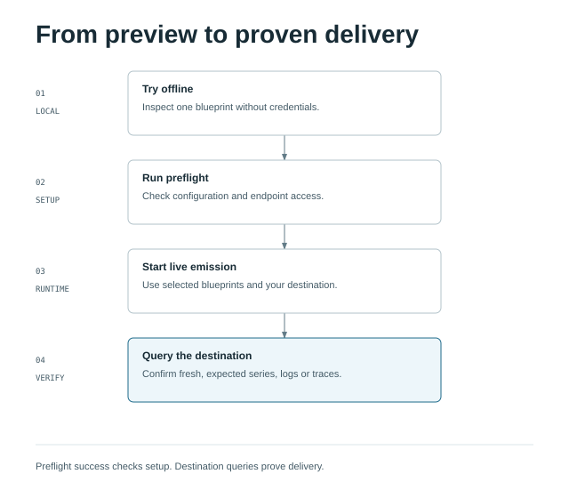

# Quick Start

This is the canonical first-run walkthrough: preview one blueprint without credentials, then
explicitly opt into live delivery. The preview is useful on its own; stop after step 2 if you
only want to explore the output.

<div class="diagram-scroll" markdown>



</div>

[Open the diagram at full size](assets/diagrams/onboarding.html).

---

## Step 1: Build

For this source path, install Git, Go 1.27.0+, Node.js 24 with npm, Bash 5+, and `just` 1.58.0+.
These commands work from a Bash shell on Linux or macOS with those tools on `PATH`.
See [Installation](installation.md) for platform notes or the prebuilt Docker path.

```bash
git clone https://github.com/rknightion/synthkit.git
cd synthkit
just ui </dev/null
go build ./cmd/synthkit
```

`just ui` installs the locked frontend dependencies and builds the assets embedded by Go.
Without that step a clean `go build` succeeds, but the operator UI displays a “not built” page.
Go and npm may download dependencies during this build.

---

## Step 2: Dry run one focused workload offline

Before touching credentials, select the bundled `otlp-native` reference blueprint and inspect its
full selected series inventory:

```bash
DRY_RUN=true SELFOBS_ENABLED=false BLUEPRINT_NAMES=otlp-native ./synthkit -env /dev/null -once -dump
```

`BLUEPRINT_NAMES` is the runtime selector. An empty or absent value starts setup mode and emits no
synthetic telemetry; comma-separated exact names select only those blueprints; `*` is the explicit
opt-in for the complete available catalog. An unknown name stops startup and lists the names that
are available. `-once` runs a single tick and exits. `-dump` prints the
complete series/label inventory to stdout — every metric name, label set, and example value that
would be pushed. No synthetic telemetry is sent. `SELFOBS_ENABLED=false` also disables the
generator’s own telemetry, which otherwise operates independently of dry-run. Use a fresh checkout
for this walkthrough; existing custom/git sources or process environment settings may change startup.

Expected output includes `selected blueprints: 1 [otlp-native]` before any sink can push, a
`loaded blueprint "otlp-native"` line, `synthkit up: 1 blueprints [otlp-native]`, and `[dry-run
promrw|loki|otlp]` summaries.

The focused runtime identities are:

- Blueprint: `otlp-native`
- Cluster: `otlp-native-prod-euw1`
- Workloads and Tempo service names: `otlp-api-enriched` and `otlp-api-naked`
- Loki stream selector for the enriched service:
  `{source="app",service_name="otlp-api-enriched",cluster="otlp-native-prod-euw1"}`

For a prebuilt container or a build from the current checkout, follow the corresponding
[installation path](installation.md). The source-build Docker override includes the same frontend
build; it requires neither Go nor Node on the host.

!!! tip "Use -dump to verify signal contracts"
    Spot-check a few metric names against the [`signals/`](https://github.com/rknightion/synthkit/blob/main/SIGNALS.md) catalogue. synthkit never invents names — anything unexpected is a bug, not a configuration choice.

---

## Step 3: Configure credentials

```bash
if [ -L .env ] || { [ -e .env ] && [ ! -f .env ]; }; then
  echo "refusing symlink or non-file .env" >&2
  exit 1
fi
if [ ! -e .env ]; then
  install -m 600 .env.example .env
else
  echo "Keeping existing .env; review its settings before continuing."
fi
chmod 600 .env
```

This creates `.env` with mode `0600` without replacing an existing file. Keep `DRY_RUN=true` while
you add credentials. The minimum set for a live push is:

```dotenv
GC_TOKEN=<your-CAP-token>
GC_PROM_RW=https://prometheus-prod-XX-<region>.grafana.net/api/prom/push
GC_PROM_USER=<mimir-instance-id>
GC_OTLP_ENDPOINT=https://otlp-gateway-<region>.grafana.net/otlp
GC_OTLP_USER=<stack-id>
GC_LOKI=https://logs-prod-XXX.grafana.net/loki/api/v1/push
GC_LOKI_USER=<loki-instance-id>
BLUEPRINT_NAMES=otlp-native
DRY_RUN=true
```

A single Cloud Access Policy token with `metrics:write`, `logs:write`, `traces:write` scopes covers all three sinks. See [Credentials](credentials.md) for the full table including optional RUM, Synthetic Monitoring, Fleet Management, and self-observability destinations.

!!! warning "DRY_RUN defaults to true"
    The shipped `.env.example` has `DRY_RUN=true`. Synthetic delivery requires `DRY_RUN=false`.
    Self-observability and explicit provisioning commands have separate controls; dry-run is not
    an authorisation switch for those operations.

---

## Step 4: Push live

```bash
./synthkit -preflight
```

Continue only if preflight succeeds for every required lane. Then start live delivery:

```bash
./plugins/synthkit/skills/initial-setup/scripts/set-env.sh DRY_RUN false .env
./synthkit
```

Preflight makes network calls: it sends empty authenticated requests and must report `ready` for Prometheus, Loki, and
OTLP before you disable dry-run. It prints only redacted lane states and reason codes.

synthkit loads `.env` automatically; exported process variables override file values. Remove any
previously exported `DRY_RUN` or `BLUEPRINT_NAMES` override if it conflicts with your file. It runs the emit loop continuously (default tick: every 5 seconds). Let it run for a few ticks so cumulative counter series accumulate before querying.

To run a single tick and exit:

```bash
DRY_RUN=false ./synthkit -once
```

---

## Step 5: Verify the focused workload

**Fastest signal — the operator UI:**

Open [http://localhost:8088/control/ui](http://localhost:8088/control/ui) in your browser. The sink-readiness strip shows the last push result for each sink (`promrw`, `loki`, `otlp`). Green = pushing successfully. If any sink shows failures, check the error detail there before querying Grafana.

**Via the JSON API:**

`curl -u control` prompts for `CONTROL_TOKEN` without echoing it. Press Enter only for an
intentionally token-free loopback run.

```bash
curl -fsS -u control http://localhost:8088/control/status | jq -e '.dry_run == false'
```

This must print `true`; otherwise `DRY_RUN` is still set incorrectly. Each sink should also show `last_success_ms` advancing and `failures: 0` in the operator UI.

`jq` is optional. If it is not installed, use the dependency-free form below and confirm that the
response contains `"dry_run":false`:

```bash
curl -fsS -u control http://localhost:8088/control/status
```

A successful push is the local delivery result. Complete the remote read-back below before calling
the deployment verified. Stop the foreground process with Ctrl-C when finished.

**In Grafana:**

1. Open Explore in your Grafana Cloud stack.
2. In Prometheus, query the enriched service's native-OTLP histogram count:
   ```promql
   http_server_request_duration_seconds_count{service_name="otlp-api-enriched"}
   ```
   Expect one or more non-empty series. To also confirm the k8s-enriched identity, query:
   ```promql
   target_info{service_name="otlp-api-enriched",k8s_cluster_name="otlp-native-prod-euw1"}
   ```
   Expect a gauge-1 series. The native active-request metric is also non-empty and is a gauge,
   not a `_total` counter:
   ```promql
   http_server_active_requests{service_name="otlp-api-enriched"}
   ```
3. In Loki, query:
   ```logql
   {source="app",service_name="otlp-api-enriched",cluster="otlp-native-prod-euw1"}
   ```
   Expect log lines after a few ticks.
4. In Tempo, use TraceQL:
   ```traceql
   { resource.service.name = "otlp-api-enriched" }
   ```
   Expect one or more traces; open one to confirm a root HTTP request span for the selected
   service. Repeat the three checks with `otlp-api-naked` to compare its non-enriched resource
   shape.

!!! info "Ingestion lag"
    Mimir and Loki typically ingest within seconds. Tempo trace search has a short ingestion lag (30s–2m) before new traces appear in search results.

---

## Next steps

- [RUNBOOK.md](RUNBOOK.md) — deep verification walkthrough (sink readiness, gcx queries, end-to-end trace correlation check, log correlation, SM/FM verification)
- [Deployment](deployment.md) — standing production deploy with docker-compose, the persistent state volume, and the host bind setup
- [Blueprints overview](blueprints.md) — write your own blueprint
- [Contributing](contributing.md) — developer and agent workflows
- [Incidents & Scenarios](incidents.md) — declare and activate failure scenarios
