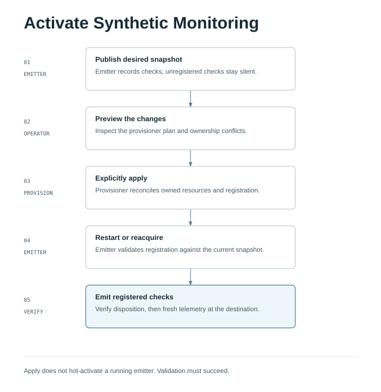

# Synthetic Monitoring

synthkit emits Grafana Cloud Synthetic Monitoring data — `probe_success`, `probe_duration_seconds`, the full SM histogram family, `sm_check_info`, and the SM Loki log stream — with no real probe ever executing. The SM app becomes populated with checks, probe status, and check history purely from injected telemetry.

This requires a two-phase startup: a one-shot provisioner registers the offline probe and checks with the SM API before the data-plane emitter produces useful output.

---

<div class="diagram-scroll" markdown>



</div>

[Open the diagram at full size](assets/diagrams/sm-activation.html).

## Why two phases

The Grafana Cloud SM app hard-guards on its own check registry: it clamps timelines to `check.created` and will not display injected metrics for checks it does not know about. Metric injection alone is not enough. The offline probe must be registered first, the checks must be created (or updated) in Grafana Cloud, and then the data-plane emitter can push forward-in-time data that populates the SM views.

Probe name, region and coordinates resolve from the blueprint through `internal/construct/sm`, so the provisioner snapshot and emitter share the same location. Checks may declare `latitude` and `longitude` together; omission retains Frankfurt (50.1109, 8.6821). Explicit zero is valid. Latitude must be within -90 to 90 and longitude within -180 to 180, both finite. Every check using the same probe name must agree on region and coordinates, including across blueprints. The emitter derives the precision-12 `geohash` on `sm_check_info` from those coordinates.

Changing a probe location changes its desired specification. Follow the preview/apply/restart sequence below to update the owned probe and activate the new snapshot.

---

## Credentials

SM provisioning uses a dedicated SM API token — separate from `GC_TOKEN` and from all other sinks.

| Env var | Description |
|---|---|
| `GC_SM_URL` | SM API base URL, e.g. `https://synthetic-monitoring-api-<region>.grafana.net` |
| `GC_SM_TOKEN` | SM API bearer token (not `GC_TOKEN`) |

The provisioner never scans blueprints. The emitter resolves the exact selected built-in, custom,
and Git sources, plus the persisted live-applied blueprints it restores, and publishes an exact
snapshot. A live apply of an SM blueprint republishes it for the running set
([live apply](custom-blueprints.md#apply-live-without-a-restart)). File mode uses private files under `/data/runtime`;
Kubernetes mode uses a named aggregate ConfigMap and requires no shared volume. The provisioner reads only
that snapshot. `SM_PROVISION_APPLY` is its independent write gate; emitter `DRY_RUN` is irrelevant.

See [Credentials](credentials.md) for token-scoping guidance.

---

## Phase 1 — provision the offline probe and checks

Start the emitter once with the intended SM blueprint selected, or apply it live. Until a matching
registration exists, synthkit writes the snapshot but suppresses SM emission. Do not live-apply an
SM blueprint while `sm-provision` runs: a live apply that changes the snapshot while a provisioning
mutation is pending is refused with `503` `sm_state_busy` (on the file state backend, where
`sm-provision` holds the state lock for its whole run, it returns `503` `sm_state_unavailable`), and a
change published between preview and
apply makes the apply refuse on its snapshot binding. Preview the version-matched
Docker provisioner:

```bash
docker compose up -d synthkit
docker compose --profile sm-provision run --rm sm-provision
```

The preview reports action counts only and makes no remote mutation. Apply explicitly after review:

```bash
SM_PROVISION_APPLY=true docker compose --profile sm-provision run --rm sm-provision
docker compose restart synthkit
```

The restart is the activation boundary. On startup the emitter validates activation schema 2,
exact specification/target hash, complete resource IDs and authoritative API `modified` bindings.
Release version is provenance, not part of that hash: an already complete registration at release A
remains active at B when every specification field, target and schema is unchanged. The write tool
must still match the **current snapshot source version**, before inventory and on every state write.
Adoption/migration approvals retain their strict source-version binding.

### Per-blueprint activation

Activation is decided per blueprint, so one blueprint's change cannot suppress another's checks.
At every start, HA leader acquisition, standby validation, live apply and live restore, synthkit
first validates the whole running set. An invalid check or a probe declared with another region
or coordinates fails startup, skips a restored live record, and rejects a live apply with `400` or
`409` respectively. A start, leader acquisition or live apply then publishes its
snapshot as before; standby validation and the live restore publish nothing and only read. It then
admits blueprint B's SM only when all of these hold:

- no provisioning mutation is pending (a pending journal suppresses every blueprint);
- the stored registration is complete and exact (schema, hash, target, every resource ID and
  `modified` binding) for one stored snapshot: the published snapshot, or the **registered
  snapshot** a later publication retained;
- that registered snapshot's target fingerprint is the configured SM endpoint and credential;
- the registered snapshot's checks whose source is B, and the probes they use, equal B's current
  checks and probes field for field (type, settings, job, target, frequency, timeout, labels, probe
  name, region and coordinates), and B declares at least one check.

A blueprint that fails the last test is stripped; the others keep their registered checks and
`config_version`. When a publication replaces the snapshot the registration is complete for, the
emitter keeps that snapshot beside the published one (`sm-registered-snapshot-v2.json` in file mode,
`registered_snapshot` in the Kubernetes document). The provisioner reads and binds only the
published snapshot; the retained one exists only for this check. It is dropped by the
provisioner's first write that replaces or removes the registration (the start of an apply's first
mutation, or its first recorded resource for the new snapshot), at the next publication after the
published snapshot is registered again, when SM is deselected, or when a publication would push
the state document past its size limit. Only a publication drops it for size, and the emitter logs
it. After a size drop every blueprint's SM is suppressed, unchanged ones included, until the
provisioner registers the published snapshot and the emitter restarts. A snapshot registered for
another SM target is never retained.
So after a live SM apply the registration does not cover, or a DELETE of a live SM blueprint, a
restart or failover keeps every unchanged blueprint emitting; only the changed or new blueprint
waits for the usual preview, apply and restart. An `sm-provision` apply replaces the registration
as it reconciles, so a restart or failover while it runs suppresses every blueprint; restart after
it completes.

Rolling the emitter or `sm-provision` back to a release without per-blueprint activation while a
Kubernetes document holds `registered_snapshot` fails closed: the older release rejects the
document as invalid SM state. An older emitter with `STATE_SM_CONFIGMAP` set refuses to start,
because its boot publication (or, with no SM selected, its invalidation) decodes the document and
rejects the unknown field; an older `sm-provision` refuses every run. Run an ordinary apply and
restart on the current release first, so the published snapshot is registered again and the
retained one is dropped.

The first v1-to-v2 format upgrade requires one explicit apply/restart. File activation uses new
`sm-snapshot-v2.json` and `sm-registration-v2.json` files. Existing v1 ownership, previews, pending
journal and lock are retained; a legacy registration can import ownership only, never activate v2.
With intact ownership and unchanged remote specs, that first apply makes no remote changes. Later
release-only upgrades need no new apply. A changed spec keeps that blueprint's SM suppressed;
partial/missing registration or any pending journal keeps all SM suppressed; unreadable/corrupt
storage fails closed rather than becoming empty state.

The provisioner owns only IDs recorded in its private durable ownership ledger. That ledger is
independent of one snapshot/source version, so a changed check can update its recorded ID while the
activation registration remains bound to the exact current snapshot. A same-name probe or same
`(job,target)` check without matching ownership is a foreign collision and causes zero writes.

Credential or endpoint rotation changes the target fingerprint and suppresses SM until an explicit
migration succeeds. Recreate the emitter with the new credential so it writes the new snapshot, then
preview and apply the migration:

```bash
docker compose up -d --force-recreate synthkit
SM_PROVISION_MIGRATE_TARGET=true docker compose --profile sm-provision run --rm sm-provision
SM_PROVISION_MIGRATE_TARGET=true SM_PROVISION_APPLY=true docker compose --profile sm-provision run --rm sm-provision
docker compose restart synthkit
```

Preview uses the new credential to revalidate every recorded API ID, key, managed specification,
and remote revision against the ledger's last authoritative evidence, but changes only a mode-0600 private preview marker. Apply must run within 15
minutes with the identical snapshot, source version, remote evidence, and plan. Only then is the
ownership ledger atomically rebound. Migration is identity-only: every planned resource action must
be unchanged, so it makes no remote API writes. Reconcile any configuration or resource change as a
separate normal apply before or after rotation. Missing or changed resources, a stale or
absent preview, or an absent migration flag fails closed. Target migration and legacy adoption cannot
be combined; finish migration first and review any later adoption separately. If the process stops
after the ledger is rebound, the marker remains and blocks normal reconciliation; rerun apply with
the migration flag to resume the unchanged plan and consume the marker.

Legacy adoption is off by default. First preview with `SM_PROVISION_ADOPT_LEGACY=true`; the
provisioner records a private hash of that exact adoption plan. A later apply accepts only the same
snapshot and plan, and only one exact complete-spec match may be adopted. A pending journal stores
the expected specification as well as its hash. An ambiguous create is never reconciled by
name/spec: inspect it and establish ownership before explicitly clearing the journal and choosing
whether to adopt. Ordinary preview and apply never delete anything; removal is the separate,
explicit [cleanup](#remove-provisioned-resources-explicit-cleanup).

`alertSensitivity` is always registered as `"none"` at the API level (the real value is stamped on the `sm_check_info` metric by the data-plane emitter independently of the provisioner).

---

## In-cluster one-shot mode — no shared volume

The binary supports `STATE_BACKEND=kubernetes` independently of emitter HA. Precreate a distinct
`STATE_SM_CONFIGMAP` and `SM_PROVISION_LEASE_NAME` in `HA_NAMESPACE`, and supply downward-API
`POD_UID`. The provisioning Lease must differ from `HA_LEASE_NAME`, including with emitter HA off.
Every writer to the SM slot must use the same provisioning Lease; the aggregate document records
that immutable lock identity. Give the tool only named get/update on that SM ConfigMap and its
Lease, projected in-cluster API credentials and the SM credential pair. There is no KUBECONFIG,
endpoint override, discovery or resource creation fallback. The emitter needs named state access
and uses its own emission authority, never the tool's provisioning Lease.

No SM request or state update occurs before acquisition. Acquisition is capped at two minutes and
the invocation at ten minutes. The tool reuses the HA duration settings: default HTTP timeout 5s,
whole-operation cap 8s and fence allowance 2s must fit strictly below Lease minus renewal (30s−15s).
State retries are 1..5 CAS attempts sharing 2s. Every mutation first persists pending evidence and
removes activation; uncertain API/state outcomes stop without replaying the mutation. Inspect retained
pending evidence before any explicit recovery. Lease authority is local admission plus bounded hard
exit, **not remote SM fencing or exactly-once delivery**. Planned termination joins work while renewal
continues, then seals and releases; unexpected loss hard-exits without release.

Kubernetes HA standby performs zero writes; acquisition publishes/revalidates the current snapshot,
covering the persisted live set, before building the production runner and its first tick. The
restore of live blueprints then only validates against that snapshot and writes nothing. File Lease HA remains suppressed without
artifact I/O. There is no automatic file-to-Kubernetes ownership migration or dual writing: moving
existing ownership needs a separately approved offline procedure. The chart supports a
[Kubernetes-state SM Job with HA emission](kubernetes.md#diskless-one-shot-job). Enable
`ha.enabled` and `smProvision.enabled`, select `smProvision.stateBackend: kubernetes`, and set
`smProvision.emitterLeaseName` equal to `ha.leaseName`. The chart wires the named SM aggregate
slot and provisioning lock identity into the emitters with named `get`/`update` only; each
principal retains its own Lease authority. Both binaries must use the same verified image, at
least **1.6.0-rc.176**, which carries the matching named-SM engine. The chart default
`1.6.0-rc.160` predates it. Preview, explicit apply, then emitter restart/reacquisition remain
required; there is no automatic activation or remote-write approval. With HA off, the
Kubernetes-state Job remains standalone and its emitter is configured separately. The default
file-mode Job retains its shared-volume behavior.

## Remove provisioned resources — explicit cleanup

Cleanup is a separate subcommand with its own preview and confirmation. It acts only on resources
the ownership ledger records as **owned** (created by synthkit) for the configured target, and only
by recorded API ID. It never searches by name, specification or folder, and never deletes
tenant-wide.

Cleanup runs whether or not SM emission is on. While the emitter publishes the SM snapshot, that
snapshot binds every durable cleanup write. Deselecting the SM blueprint, or starting the emitter
with `STARTUP_DISABLED_KINDS=synthetic_monitoring`, removes the snapshot; cleanup then binds each
write to the ownership ledger's recorded target (the endpoint and credential fingerprint) and to the
exact stored SM state it last read, as a compare-and-swap. You do not need to re-enable SM to clean
up. On the file backend the emitter cannot publish while cleanup holds the state lock: an emitter
that starts with SM turned back on during the run fails its snapshot publication instead. With
Kubernetes state the emitter can publish mid-run; cleanup's next write then refuses and no further
delete is attempted, so preview again. A cleanup write never records a
registration, so after cleanup SM stays suppressed until a later ordinary apply and restart.
In Kubernetes, run cleanup through the chart's SM Job: see
[Kubernetes](kubernetes.md#synthetic-monitoring-cleanup-job).

```bash
docker compose --profile sm-provision run --rm sm-provision cleanup
SM_PROVISION_APPLY=true docker compose --profile sm-provision run --rm sm-provision cleanup -confirm=<plan>
docker compose restart synthkit
```

The preview lists each recorded resource and prints a plan hash. It makes no remote or state
change. The plan hash covers the target, the snapshot (or, with none published, a custody marker
for the recorded target) and, for each resource, its ID, revision,
managed specification hash and planned action. Apply needs `SM_PROVISION_APPLY=true` and that exact
hash. If anything changed since the preview, apply refuses before any write. Cleanup cannot be
combined with `SM_PROVISION_ADOPT_LEGACY` or `SM_PROVISION_MIGRATE_TARGET`. A live SM apply, or
the restart after a DELETE of a live SM blueprint, changes the published snapshot and so the plan
hash: preview again after either. Turning SM off or on between preview and apply changes the plan
hash too.

Before every delete, cleanup lists the inventory again and checks that the resource's ID, key,
revision (`modified`) and managed specification still match the ledger. A probe still referenced
by any check that is not being deleted is kept. This check is the only concurrency guard: the SM
delete API (`DELETE /api/v1/{check,probe}/delete/{id}`) has no revision precondition, so a change
made between that last inventory and the delete cannot be detected. Checks are deleted before the
probes they use.

Cleanup refuses the whole operation, with no writes, when custody is foreign, changed, legacy or
incomplete:

- an owned resource's revision, specification or key changed remotely
- the ledger is bound to another target, or the configured credential does not match the snapshot
  or, with no snapshot published, the ledger's recorded target. Credentials are never substituted.
- a published snapshot was written by another synthkit version
- legacy ownership has no recorded specification hash, or only a legacy registration exists. Run
  an ordinary apply first to bind custody.
- no ledger exists
- a target migration is incomplete
- a create or update journal is pending

Resources recorded as adopted are never deleted. They stay in the ledger and the receipt reports
them as `retained`.

Each delete first stores a pending delete intent: the exact target, ID, revision and specification
hash. In the same state write it removes activation, so the emitter stays suppressed after its next
restart. Only an inventory read showing the ID gone counts as absence; a successful delete response
alone does not. Absence removes the resource from the ledger and clears the intent in one state
write. A lost response, timeout, termination or crash leaves the intent in place, and ordinary
preview and apply refuse while it remains. The next `cleanup` run resolves it first. If the ID is
gone, it records the absence. If the resource is unchanged, the delete is planned again. If it
changed, cleanup refuses for operator review. A killed file-mode run leaves the private lock, which
is never guessed stale: remove it only after confirming no provisioner is running.

Every run that reaches a plan prints one secret-free JSON receipt line (`cleanup receipt: {...}`):
kind, API ID, `config_version`, outcome, reason and, for a rejection, the HTTP status only. It never
includes keys, check targets, response bodies, credentials or the target fingerprint. A refused run
prints no receipt, only the refusal. Apply outcomes are `confirmed_absent`, `unknown` (the intent is
retained), `rejected`, `not_attempted` and `retained`. The status is `complete`, `remaining` (only
retained resources are left; exit 0), `unknown`, `rejected` or `stopped` (all exit non-zero, with
custody retained).

`rejected` means the API answered the delete with a definite 4xx (for example 403 when the token
lacks delete permission) and the next inventory still shows the resource. The pending intent is
kept and there is no abandon path. Fix the SM token's permission, then preview and apply cleanup
again; the unchanged identity is planned for deletion once more. Until cleanup completes, ordinary
preview and apply stay blocked by the pending intent. An emitter that
is already running is not deactivated in place; restart it, or remove the SM selection, after
cleanup. In Kubernetes mode cleanup runs under the same provisioning Lease as apply and makes no SM
request or state update before acquiring it.

## Phase 2 — run the emitter

After the successful apply and required restart, verify the authenticated disposition first:

```bash
curl -s -u control http://127.0.0.1:8088/control/status |
  jq '.optional_lanes[] | select(.lane=="synthetic_monitoring")'
```

Require `state="enabled"` and `verification="verified"`, then wait one declared emission interval
plus `SEND_BATCH_DEADLINE` before querying `probe_*` data. A successful provisioner exit without
the restart is not activation.

The SM emitter pushes per-tick:

- `probe_success` (gauge, 0/1)
- `probe_duration_seconds` (gauge)
- `probe_all_success_sum` / `_count` (summary counters)
- `probe_all_duration_seconds_bucket` / `_sum` / `_count` (histogram, buckets `[0.005, 0.01, 0.025, 0.05, 0.1, 0.25, 0.5, 1, 2.5, 5, 10]`)
- `sm_check_info` (info gauge, carries `check_name`, `region`, `frequency`, `geohash`, `alert_sensitivity`, user labels)

Each check also emits a Loki log line per tick with stream labels `{source="synthetic-monitoring-agent", check_name, instance, job, probe, region, probe_success}` and a logfmt body (`msg="Check succeeded"` or `"Check failed"`, `duration_seconds`).

Base labels on every series: `job` (check job), `instance` (check target URL), `probe` (probe name), `config_version`. User labels declared in the blueprint become `label_<k>` labels on both metrics and the Loki stream.

!!! warning "config_version is a stable join key"
    All SM series join on `(instance, job, probe, config_version)`. `config_version` encodes the check's `modified` timestamp. If you re-provision after editing a check, all series must be re-stamped with the new `config_version`. A successful explicit apply followed by restart/acquisition injects the new authoritative value; an already running process is not hot-activated.

---

## Blueprint configuration

Checks accept `type: ping`, `type: dns`, `type: tcp` and `type: traceroute`;
omitted `type` retains HTTP. Ping/traceroute targets are hostnames or IPv4 addresses.
DNS targets are queried names and require `dns: {server: resolver.example.com}`;
the supported profile uses A queries over UDP port 53. TCP targets use `host:port`
and optionally `tcp: {tls: true}`. Network checks default to 60-second frequency
and 3-second timeout, except traceroute, which defaults to 120 seconds and requires
a 30-second timeout. Wrong-type settings and malformed targets are rejected.

Traceroute emits one logfmt entry per simulated hop. Its aggregate packet-loss
metric is a 0–1 fraction; hop `LossPercent` is 0–100. HTTP and network duration histograms use
the pinned agent v0.66.1 default buckets, including the four sub-100ms bounds.
The [signal contract](https://github.com/rknightion/synthkit/blob/main/signals/sm.md#synthetic-monitoring-fake-sm-checks-slug-sm-checks)
records the predecessor subset and source provenance.
TLS certificates model a synthetic CA with 90-day validity and renewal every 60 days.
Their identities and expiry remain fixed between renewals. These are simulated checks,
not network observations or certificate verification against the declared endpoint.

The sample blueprint includes all four network types. Existing HTTP-only snapshot
hashes remain unchanged. Adding or changing a check type/settings changes its desired
specification and requires the usual preview/apply/restart sequence.

Enable SM by adding a `synthetic_monitoring` block under `features:`:

```yaml
features:
  synthetic_monitoring:
    enabled: true
    checks:
      - name: my-api-health
        target: "https://api.example.com/health"
        frequency: 60000         # ms; default 60000
        probe: synthkit-private  # must match the registered probe name
        region: EMEA
        labels:
          team: platform
          tier: api
```

Each check entry becomes one registered SM check and one emitted series family. `target` defaults to `https://<name>.example.com/health` if omitted.

See [`blueprints/synthetic-monitoring.yaml`](https://github.com/rknightion/synthkit/blob/main/blueprints/synthetic-monitoring.yaml) for a complete example combining SM checks with a Fleet Management collector roster.

---

## Failure mode

The `sm_probe_failure` incident mode targets a specific check and environment: it sets `probe_success=0`, `probe_duration_seconds=3.0` (the SM timeout), and emits a Loki log line with `probe_success="0"` and `msg="Check failed"`. See [Incidents](incidents.md) for how to declare and activate failure modes.

---

## See also

- [`signals/sm.md`](https://github.com/rknightion/synthkit/blob/main/signals/sm.md) — full signal contract with label shapes, histogram buckets, and provenance
- [CLI](cli.md) — `sm-provision` command reference
- [Configuration](configuration.md) — complete environment variable reference
- [Credentials](credentials.md) — SM token scoping
