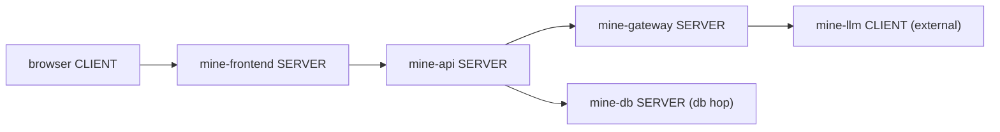

# Workloads

A workload is the request-generating layer of a blueprint. Where constructs emit infrastructure telemetry on a fixed tick, a workload mints correlated request samples per master tick and projects them across traces, logs, and optionally RUM — threading one correlation key-set through every signal class so a trace ID in a span matches the same ID in the application log and the browser beacon.

Three workload kinds are registered:

- **`web_service`** — a single service: a browser→backend→DB hop tree with optional gen_ai/LLM hops, RUM, Beyla, and profiling. Simple and common.
- **`app`** — a blueprint-declared service graph of typed nodes, each with its own custom metrics/logs/spans via the telemetry DSL, and one end-to-end correlated trace across the whole graph. Use when you need multiple backend services each with distinct telemetry, per-service incident targeting, or per-service scaling.
- **`ai_agent`** — coding-agent sessions with correlated turns, model calls, evaluations and optional Sigil generation ingest. The shipped `grafana-ai-o11y` blueprint demonstrates this workload; its complete field surface is in the [generated schema](https://github.com/rknightion/synthkit/blob/main/BLUEPRINT-SCHEMA.md). Sigil uses `GC_SIGIL_*`, separately from OTLP traces and metrics.

For Agent Observability's current span/metric vocabulary, inclusive token semantics,
legacy synthetic evaluation rules (`execution_mode`, `filterable_tag_keys`), and the
strict SDK-versus-backend producer split, use the [canonical signal contract](https://github.com/rknightion/synthkit/blob/main/signals/sigil.md).
Do not mix synthetic evaluation emission with real backend rules scoring the same agents.

These kinds may coexist in one blueprint: model the core correlated flow as an `app`, and simpler peripheral services as standalone `web_service` workloads.

## web_service

`web_service` models a single backend service. One minted request produces:

- A **trace**: optional browser CLIENT root span → backend SERVER span → one CLIENT span per downstream call (database or cache hops, with `db.*` semantic conventions). Traces are backdated so they end at approximately `now`, matching how real spans export on completion.
- **Application logs**: one structured log line per request, correlated by trace/span ID.
- **APM span-metrics**: `traces_spanmetrics_*` histograms + service-graph series on the 60-second metric tick.
- Optional **Faro/RUM beacons** when `rum: true` and `GC_FARO_*` credentials are present.
- Optional **Beyla eBPF** observation lane when `observability.beyla` is set.
- Optional **Pyroscope SDK-push profiles** when `pyroscope:` is set with `mode: sdk`.

Synthetic workload profiles are a customer-data lane: they require a selected workload/profile
declaration plus `GC_PROFILES_URL`, `GC_PROFILES_USER`, and customer `GC_TOKEN`, followed by a fresh
Pyroscope delivery. They are distinct from synthkit **process profiling**, which follows
`SELFOBS_ENABLED` and the separate staff `GC_PYROSCOPE_*` triplet.
- Optional **native OTLP application metrics** (`http.server.*`) when `otel.metrics: true`.

### Key fields

```yaml
workloads:
  - type: web_service
    name: mine-api
    runs_on: mine-prod-use1      # binds to a cluster by its declared name
    tracing: true                # default true; false omits the OTLP lane
    rum: true                    # requires GC_FARO_* creds; omit or false = disabled
    traffic:
      off_peak_rps: 10           # trough request rate (default 5)
      peak_rps: 80               # plateau request rate (default 50)
    endpoints:
      - { route: "GET /v1/search",  error_rate: 0.01, p95_ms: 140 }
      - { route: "POST /v1/items",  error_rate: 0.02, p95_ms: 220 }
    calls:
      - { db: mine-app-db }      # resolved to the named database fixture
      - { cache: mine-sessions } # resolved to the named cache fixture
```

`traffic` drives the **metric lane** volume (span-metrics RPS). The correlation narrative (one request per master tick) is separate and smaller by design — it seeds realistic trace/log samples without inflating span-metric series cardinality.

`endpoints` are drawn uniformly across each minted request; `error_rate` and `p95_ms` shape the per-route latency distribution and error fraction in both spans and span-metrics.

### gen_ai / LLM hops

When a blueprint wires an AI infrastructure construct (AgentCore, Bedrock) to the same cluster, `web_service` emits in-process `gen_ai.*` span attributes and correlated AI logs on the backend span. No additional YAML is needed on the workload; the gen_ai trace vocabulary comes from `internal/genai` (the same seam used by `app`).

## app

`app` declares a **multi-service graph** where each node is a first-class service with its own telemetry. One request minted at the entry node propagates a single correlated trace across the whole graph: every node adds its own SERVER span (and optional CLIENT spans to its downstream calls), so the resulting trace shows the full request journey across all services.

### Bound Agent Observability executor (component boundary)

The `agent_pipeline` app component binds `services[].agent_observability` to placed
service identities and executes one correlated request incrementally. Every pipeline
Build requires the canonical `GenerationStages` collaborator, even with hooks disabled
and ratings at zero. This is a construction dependency, not a receipt or admission
attestation. The composition root must install it only after actual selected-set,
destination and retained real-only custody admission. A positive rating sample rate
additionally requires `Ratings`; neither collaborator provisions backend rules.

**Not an operational CLI feature yet:** ordinary boot, live apply and persisted restore
cannot inject these collaborators and reject/record a restore skip, even with hooks off
and ratings zero. The controlled test fixture under `e2e/fixtures/` exercises public
loading/KSM placement plus explicit component injection, not runtime admission. Do not
copy its forced rates into a shipped blueprint or install a no-op collaborator to bypass
the fence. Production adapters, retained custody and backend graph/readback remain separate.
The [canonical bound-app signal subset](https://github.com/rknightion/synthkit/blob/main/signals/sigil.md#bound-app-executor-subset-slug-sigil-app-pipeline)
is sourced to SDK 75a1c548 and must not be generalized to unrelated `ai_agent` behavior.

The generation binding's `content_facets` selects the exact unordered corpus facet set;
omission selects facetless turns only. Textual user and assistant candidates are both
required, without fallback or implicit corpus-tool execution. Retrieval tools use
explicit `name`, `kind: tool_result` and exact `facets`; only tools selected by both
producing caller and source binding execute. The producer owns preflight policy;
retrieval-only enabled hooks reject. Backend rules match planner identity, never an
invented tool-name predicate. Explicit deny stops dependent execution. Hook-local
fail-open and explicitly disabled hooks may carry original content; they do not certify
redaction. When a hook replaces or denies a result, original content is confined to the
intended evaluator input and must not reach downstream generation/tool content.

Capture follows the pinned SDK native-generation versus tool-span split:

| Mode | Native generation export | Tool span arguments/results |
|---|---|---|
| Omitted / `default` / `no_tool_content` | Full content | Omitted (this component has no per-tool IncludeContent opt-in) |
| `full` | Full content | Accepted content included |
| `full_with_metadata_spans` | Full content | Omitted |
| `metadata_only` | Content stripped; roles, parts, tool names/IDs, usage and timing retained | Omitted |

Metadata-only removes SDK content mirrors, not arbitrary authored metadata/tags. The
pinned Go policy removes current and legacy title mirrors plus call_error; the pinned
Python policy removes current title and call_error, not an authored legacy-title key.
Keep authored metadata/tags free of private content. Metadata-only capture of a
thinking part clears its content and keeps the part a thinking part through the explicit
part kind, so it encodes as an empty thinking payload rather than text; no placeholder
content is emitted. The app corpus path does not produce media parts;
reduced Python media is refused rather than claimed as supported.

Every service in a pipeline graph must have an Agent Observability binding and be used
by its stage plan; unbound graph leaves/hops are unsupported. Inline `logs`, log-producing
catalog profiles, `pages` and `rum_faro` reject at Build rather than being silently ignored.
The executor does not add ordinary app log/RUM projection. These restrictions apply only
to `agent_pipeline`; ordinary app graphs retain their existing behavior.

Limits are 16 stages, 3 revisions, 32 expanded attempts and 1 MiB total modeled content.
The native SDK metric subset is cumulative duration/token usage only, partitioned by
actual service/SDK. Tools-only source emits workflow/tool telemetry, never a model
Generation or model metric. Local synthkit-derived spanmetrics reject when enabled;
root must refresh that flag before projection to enforce a composed live-toggle fence.
Backend graph derivation from actual traces is separate evidence. Minimal component
ratings omit arbitrary comments/metadata; do not infer blanket metadata scrubbing or
backend conversation delivery from rating acceptance.

### Service nodes

Each node in `services:` is a `ServiceNode`:

| Field | Description |
|---|---|
| `name` | Unique graph identity; stamped as `service` / `service_name` label on every signal from this node. |
| `type` | Span semantics. Valid values: `frontend` / `web` / `grpc` / `worker` / `job` / `stream` / `gateway` / `db` / `cache` / `llm` / `agent` / `tool` / `workflow` / `retrieval`. Unknown types fall back to a default. |
| `runtime` | `go` / `jvm` / `node` / `python` — selects the catalog runtime profile. |
| `entry` | `true` on exactly one node: the graph's request entry point. |
| `worker` | `true` on the entry only: it consumes `traffic.from_resource`, its root span is CONSUMER, and each request records the queue's backlog wait. |
| `replicas` | Pod count for the k8s substrate cascade (default 2). |
| `calls` | Downstream node names (graph edges). |
| `uses` | Declared `environments[].resources` a request meets on arrival at this node, in order; a name resolves as `<name>-<lower(env)>` first, then exactly. Needs `environments[].resources`. See [Causal requests](#causal-requests). |
| `routes` | Request routes drawn per-request. On the entry node these populate `r.Route`; on a callee they name its SERVER span. |
| `profiles` | Catalog profile template names applied to this node. |
| `metrics` / `logs` / `spans` | Inline custom telemetry via the DSL (the escape hatch). |
| `external` | `true` = remote/managed service: appears as a trace hop but is not deployed as a k8s pod on the caller's cluster. |
| `agent_observability` | Bound-app SDK identity/content selection; requires `agent_pipeline` and injected collaborators, not yet ordinary CLI activation. |
| `agentic_flow` | In-process LangGraph orchestration — emits `invoke_workflow` → `invoke_agent` → `execute_tool*` → `chat` span subtree inside this node's SERVER span. |
| `pages` | RUM navigation inventory (frontend entry nodes only). Page-views are RUM-only: they model session navigation around the traced action and emit no backend trace. |

### Call policies and retry semantics

With declared `environments[].resources`, a service's `call_policies` give a per-callee client
policy keyed by names in its `calls`: `timeout_ms` (0 = none), `retries` (0 to 3), `backoff_ms`
(doubled per resend), `retry_on` (`5xx`, `throttle`, `timeout`, `connect`) and `propagate_throttle`.
`timeout_ms` and `backoff_ms` are each at most 600000 (ten minutes); a larger value is rejected at
load. The retry rules:

- The service that calls the target never resends a rule rejection or a credential failure.
- An upstream caller that only sees the mapped status may. An unabsorbed credential failure reaches
  the next caller up as a 502, which a `retry_on: [5xx]` policy there resends; each resend meets the
  same credential failure once more at the direct caller.
- A rule rejection slower than the caller's `timeout_ms` reaches the caller as a timeout (a client
  that times out cannot know the cause), so `retry_on: [timeout]` resends it. With no timeout, or a
  timeout longer than the rejection, the same rejection is made once.

### Service graph example

```yaml
workloads:
  - type: app
    name: mine-app
    runs_on: mine-prod-use1
    traffic:
      off_peak_rps: 5
      peak_rps: 40
      request_latency_p95_ms: 9000   # LLM-call budget; default 200ms suits plain HTTP
    models:
      - { model: gpt-4o,             provider: azure-openai }
      - { model: claude-3-5-sonnet,  provider: bedrock }
    services:
      - name: mine-frontend
        type: frontend
        entry: true
        runtime: node
        replicas: 2
        routes: ["GET /", "GET /search"]
        profiles: [rum_faro, runtime_node]
        calls: [mine-api]

      - name: mine-api
        type: web
        runtime: go
        replicas: 3
        profiles: [scraped_http_server, runtime_go, gen_ai_client]
        calls: [mine-db, mine-gateway]

      - name: mine-gateway
        type: gateway
        runtime: go
        replicas: 2
        profiles: [gateway_export_log]
        calls: [mine-llm]
        external: false

      - name: mine-llm
        type: llm
        external: true              # managed endpoint: trace hop only, no k8s pod
        calls: []

      - name: mine-db
        type: db
        runtime: go
        db_instance: mine-app-db   # links to the RDS fixture for db.* CLIENT span attrs
        calls: []
```

The resulting trace shape:



### Models and gen_ai hops

The top-level `models:` list declares valid (model, provider) pairings. The app minter draws one pair per request and stamps it into the correlation — so `gen_ai.*` span attributes, gateway export logs, and eval log entries all carry the same model and provider for that request. Pairing prevents impossible combinations (e.g. a Claude model on the Azure-OpenAI provider).

An `agentic_flow` on a node adds a nested gen_ai span subtree inside that node's SERVER span:

```yaml
- name: mine-api
  type: web
  runtime: go
  agentic_flow:
    workflow: mine-search-workflow
    agents:
      - name: search-agent
        tools: [vector_search, rerank, summarise]
    omit_chat: false    # false = include the chat <model> leaf (the LLM call)
```

Set `omit_chat: true` when a connected `gateway` or `llm` node already models the LLM call so it is not double-counted.

### Causal requests

An `app` becomes causal when it declares `uses` on a service node, `call_policies`, `worker` or
`traffic.from_resource`, against `environments[].resources`. Each request's outcome, status and
timing then derive from resource state and active faults (the
[resource axis](incidents.md#resource-axis-causal-resources)) instead of an independent draw, and
every signal projects the same request facts. The field reference is the generated
`BLUEPRINT-SCHEMA.md` (`services[].uses`, `services[].worker`, `traffic.from_resource`,
`traffic.success_status`, `traffic.error_mix`).

- **Traces.** A failing request's origin span is ERROR and carries the cause as its status
  description, `error.type`, and the mapped HTTP status where one applies; retries are separate CLIENT
  spans with `http.request.resend_count`; a `worker` entry's root span is CONSUMER. No `exception`
  span event is emitted, because the pinned semantic conventions deprecate it. See
  `signals/traces.md`, section `traces-app-causal`, for the status rules and sources.
- **Logs.** In a request carrying a fault or a failure, each service logs from its own hop: the log
  `ref` names listed in the Telemetry DSL section below. A service the request never reached logs nothing.
- **Span metrics and service graph.** In a metric window that holds a faulted or failed request,
  each row's latency cycles through the window's real span durations for that row and status, and
  an edge's volume is scaled by the calls to its callee per sampled request, so retries count. A
  `worker` entry's row is `SPAN_KIND_CONSUMER`, and a `traffic.from_resource` app's request volume
  is the queue's served rate. Windows with no fault or failure, and workloads that declare no
  resources, take the established path unchanged.
- **Custom metrics.** The `resource` and `outcomes` value models read the same state and the node's
  hop outcomes for the window.
- **Unbound nodes stay as they were.** A service that names no resource keeps its legacy request
  facts field for field, and a healthy causal request keeps the legacy spans and logs. The one
  difference is a hop failure from `error_spike` or a declared `error_rate`, which in a causal
  workload propagates by the mapped status and can be absorbed by a retry, and in any other
  blueprint stays independent (see the
  [service axis](incidents.md#service-axis-app-workload-per-node)).

### Telemetry DSL

Each node can declare custom metrics, log streams, and extra span attributes via inline DSL specs. The DSL is the `profiles:` escape hatch — use catalog profiles first, inline specs for anything not covered.

**Value models** (exactly one per field):

| Kind | YAML | Description |
|---|---|---|
| `const` | `const: 42.0` | Fixed numeric value |
| `const_str` | `const_str: "ok"` | Fixed string |
| `enum` | `enum: [{value: "read", weight: 3}, {value: "write", weight: 1}]` | Weighted categorical draw |
| `int_range` | `int_range: {min: 0, max: 100, p_zero: 0.95}` | Bounded integer; `p_zero` forces 0 with given probability |
| `float_range` | `float_range: {min: 0.001, max: 2.5}` | Bounded float |
| `normal` | `normal: {mean: 50.0, stddev: 10.0}` | Gaussian draw (negative clamped to 0) |
| `lognormal` | `lognormal: {median: 120, p95: 3600}` | Right-skewed positive draw with the given median and 95th percentile (see below) |
| `bool` | `bool: {p_true: 0.1}` | Weighted boolean |
| `shape` | `shape: {base: 100.0, mode: latency_storm}` | Legacy `base × load × incident multiplier`; optional metric-only `incident_value` selects an explicit endpoint instead, and `incident_absolute` keeps that endpoint off the load curve (see below) |
| `now` | `now: {}` or `now: {stall_mode: error_spike}` | The tick time in Unix seconds (gauge metric values only), for a collector heartbeat. Plain `now: {}` advances every tick whether or not work succeeded. With `stall_mode`, the gauge holds its last reading while that incident mode is active on the service the metric belongs to and resumes at the tick time afterwards, so a last-success-age alert can fire; a stall already active on the first tick holds that tick's reading, and the hold is not persisted across a restart. Never the wall clock; `value_scale` is rejected on its labels |
| `resource` | `resource: {name: db-pool, field: utilization}` | A field of a declared `resources:` entry's model state (metric values only). Gauge fields `demand_rps`, `capacity`, `utilization`, `in_use`, `waiting`, `wait_seconds`, `backlog`, `oldest_age_seconds`, `latency_factor`, `hold_seconds`, `served_rps`, `failed_share` need a gauge metric; counter fields `rejected`, `admitted`, `failed` (window sums since the last tick) need a counter metric. Reads 0 where the workload supplies no model |
| `outcomes` | `outcomes: {status: [5xx], measure: share}` or `{status_label: code, measure: count}` | The node's hop outcomes in the metric window (metric values only). `status` lists `success`, `4xx`, `5xx` or exact three-digit statuses; alternatively `status_label` names an `enum` label of the same metric whose values are such statuses and select the status per series (set exactly one of the two). `measure` is `count` (default, counter metric), `share` (gauge metric) or `latency` (histogram metric, one observation per matching hop duration in seconds). Reads 0 where the workload supplies no outcomes |
| `request_draw` | `request_draw: {key: order, format: "ORD-{digits:10}"}` or `{key: path, enum: [{value: /v1/orders, weight: 6}, {value: /v1/items, weight: 3}]}` | A value drawn once per request and shared by every log line of that request that names the same `key` (log body fields only), so a multi-line log bundle carries one fresh ID and one path instead of a fixed specimen. Set exactly one of `format` and `enum`. `format` is literal text with generated runs `{digits:N}`, `{hex:N}` (lower case) or `{upper:N}` (upper case letters and digits), N from 1 to 32 and at most 64 generated characters in all; literal braces are not supported. `enum` is a weighted categorical draw (weights are the share of requests; `rate_scale`, `value_scale` and `shape_profile` are rejected). The draw hashes the request's seed unit and mint instant, never the shape engine or the wall clock: it is deterministic for a given seed and clock, consumes no engine randomness, and an ID does not repeat across a restart. Repeat the same declaration on every line of the bundle; lines declaring a key differently draw different values. In a failing causal request every node's lines and every retried attempt share the one request's draw |
| `ref` | `ref: trace_id` | Pulls a correlation field by name |

**Capability matrix** (enforced at load time):

- **Metric labels** and **Loki stream labels**: only `const` / `const_str` / `enum`. These must enumerate a stable, total domain on every run.
- **Metric values**: only numeric models — `const`, `int_range`, `float_range`, `normal`, `lognormal`, `bool`, `shape`, and `now` on gauges, plus `resource` and `outcomes` under the instrument rules in the table above. A metric whose value is `resource` or `outcomes` rejects enum `rate_scale` and `value_scale` on its labels, since they would distort window counts.
- Enum `rate_scale` / `value_scale` are admitted on **metric labels** only (see below); a log, stream-label or span enum carrying them is rejected.
- **Log body fields** and **span attributes**: any model, including `ref`, except `shape.incident_value`, `now`, `resource` and `outcomes` (metric values only) and `request_draw` (log body fields only). High-cardinality correlation keys (`trace_id`, `portkey_trace_id`, `run_id`, etc.) ride here — never as labels or stream labels.
  An app `ref` can also read `error_code` (the failed request's `error_mix` code). In a causal
  request that carries a fault or a failure, each service's log lines use that service's own hop:
  `span_id`, `status`, `outcome` and the stream `level` follow it, a retried callee logs once per
  attempt at the attempt's end, and a service the request never reached logs nothing. Those lines
  can also read `error_type`, `error_message`, `exception_type`, `fault_resource`, `fault_mode`,
  `attempt` and `upstream` (the called service whose failure this service answered with).

For a metric that is genuinely zero normally but nonzero during an incident, opt into a finite,
explicit endpoint rather than fabricating a positive baseline:

```yaml
value:
  shape: {base: 0, mode: error_spike, incident_value: 12}
```

This value-only fixture illustrates the contract, not a catalog metric or a production backlog
size. Cite the real instrument and choose its endpoint from the modeled deployment. With the
option present, the metric value is `load × ((1 - intensity) × base + intensity × incident_value)`.
`load` is the app's business-hours/weekly factor including the master volume multiplier;
there is **no additional legacy ×3 incident amplification**. At unit load, the example emits
0 normally, 3 at intensity 0.25, 12 at intensity 1, then 0 immediately on recovery. A nonzero
base or an explicit zero endpoint is also supported; both endpoints must be finite numbers.

`mode` must be nonblank. Intensity comes from the existing shape engine's matching mode and
service-node scope: an exact target affects only that node, an unscoped incident affects all
nodes, overlapping contributors use their maximum intensity, and an inactive mode supplies 0.
A resolved intensity of 0 leaves the base unchanged. Scheduled explicit `intensity: 0` is a
no-op; omitted intensity defaults to 1. This applies to inline incidents and the effects of
scheduled scenario references. See the [incident presence contract](incidents.md#incidents-scheduled-activations).
Live zero intensity remains a no-op.
Master volume 0 retains the same series but emits shape gauges as exactly 0, even during an
incident; counters and histograms stop observing while paused as before.

For a duration or latency, an outage should read the same level whatever the traffic: at night the
business curve may be 0.1, so a 4,600 s incident value would otherwise read 460 s, and 64-138 s on a
weekend night. Add `incident_absolute: true` (it requires `incident_value`) to take the load curve
off the incident share:

```yaml
value:
  shape: {base: 100, mode: latency_storm, incident_value: 4600, incident_absolute: true}
```

The value is then `(1 - intensity) × base × load + intensity × incident_value`. The calm baseline
still follows `load`, the incident endpoint does not, so at intensity 1 the reading is exactly
`incident_value` at any hour, and at fractional intensity the incident share is `intensity ×
incident_value`. Master volume is part of `load`, so it no longer scales the incident share either;
an explicit volume 0 still pauses the gauge at exactly 0, and so does a `shape_profile` that reaches an
exact zero load (floor 0 or `weekend_factor: 0`): no activity, nothing to read. Omitted or `false` keeps the
`load × (...)` formula above, byte for byte. Choose it for values that are absolute levels
(durations, latencies, ages), not for rates or counts that genuinely track traffic.

`incident_value` is admitted only for metric values, never labels, log fields or span attributes.
It is stateless interpolation, not a queue growth/drain or recovery state machine: for a reversible
backlog reading choose a **gauge**. Counter values remain per-tick increments and histogram values
remain per-tick observations. Omitting `incident_value` preserves the legacy shape calculation,
including its zero-load evaluator fallback; in the metric lane an explicit master-volume pause
continues to bypass that fallback.

Example inline metric:

```yaml
- name: mine-api
  type: web
  metrics:
    - name: mine_requests_total
      instrument: counter
      labels:
        route:  { enum: [{value: "/search", weight: 3}, {value: "/items", weight: 1}] }
        status: { enum: [{value: "200", weight: 9}, {value: "500", weight: 1}] }
      value:
        shape: { base: 1.0, mode: throughput_drop }
```

### Blueprint-owned custom metrics

Use a service node's `custom_metrics` for blueprint-owned names, reusing the metric DSL above.
Every declaration requires a nonblank `source` citation identifying the instrumentation contract
or documentation for its metric name, unit and label dimensions. The loader checks that a citation
is present, not that its contents are authoritative or its URL is reachable. Citation text stays in
configuration: it is never a metric label, datapoint attribute or OTLP resource attribute. These
names are owned by the blueprint, not additions to the built-in signal catalog.

```yaml
services:
  - name: api
    type: web
    custom_metrics:
      - name: http_requests_total
        source: https://prometheus.io/docs/practices/naming/
        instrument: counter
        labels:
          method: {const_str: GET}
        value: {const: 2} # illustrative fixture: two requests per metric tick, per label combination
      - name: http_request_duration_seconds
        source: https://prometheus.io/docs/practices/histograms/
        instrument: histogram
        unit: s
        labels:
          method: {const_str: GET}
        buckets: [0.5, 1]
        value: {const: 0.75} # illustrative fixture: one 750ms observation per metric tick
```

A counter value is a **per-metric-tick increment**, accumulated across ticks. A histogram value is
one observation per metric tick, accumulated into classic Prometheus `_bucket`, `_sum` and `_count`
series; explicit strictly ascending `buckets` are required. Each label combination receives its own
increment or observation: enum weights do not divide traffic among metric series (declare
`rate_scale` / `value_scale` on the enum values for that, below). Values are not
request-ledger-derived business outcomes; choose tick frequency and value models from the cited
instrumentation and realistic workload volume, rather than treating these fixture values as
production traffic defaults.

Custom metrics always use the existing Prometheus lane. Workload-level `otel.metrics: true` also
mirrors these observations as native cumulative OTLP sums/histograms with stable start times;
node identity becomes resource attributes while declared labels remain datapoint attributes.
With `otel.metrics` omitted or false, no native metrics are emitted. Catalog profiles remain on
the Prometheus lane. Gauges and the rest of the metric DSL are also supported.

Only bounded `const` / `const_str` / `enum` label domains are admitted; high-cardinality keys such
as `trace_id` and high-cardinality `ref` values are rejected even if a key has a constant value.
Node identity keys remain reserved. Put correlation identifiers in log bodies or span attributes,
not metric labels. At workload build, each custom declaration must own a distinct instrument name
and its entire Prometheus family within the service node: a histogram also reserves `_bucket`,
`_sum` and `_count`. Collisions with profiles, legacy `metrics` or other custom declarations are
rejected even when labels are disjoint or units/bounds differ; declarations are never merged.
Existing `metrics` declarations and catalog profiles retain their previous
validation and emission behavior; `custom_metrics` is the additive, citation-required surface.

### Per-value scales, derived metrics and workload load profiles

These are opt-in. Omitting them leaves every series and value exactly as before.

**Per-value scales.** A metric label enum value may declare `rate_scale` and `value_scale`
(finite, `>= 0`, default 1). The label domain is unchanged; the scales only change what each
combination observes. A histogram combination is absent until its first observation, so one with
`rate_scale: 0` never appears and one below 0.5 first appears on a later tick. With several scaled labels the combination's multiplier is the product.

| Instrument | `rate_scale` | `value_scale` |
|---|---|---|
| counter | multiplies the per-tick increment | rejected (an increment is a rate) |
| histogram | observations per tick (each its own draw); fractions carry across ticks, rounding half up from the first tick | multiplies each observed value, so mean and p95 move together |
| gauge | rejected | multiplies the reading |

`weight` is unchanged: it still steers only per-request draws (log bodies, span attributes).
They belong under `labels.<key>.enum[]`. The generated schema does not expand `labels` maps
(it shows them as `map[string]ValueModel`) and so lists `rate_scale` / `value_scale` only under
`value.enum[]`, where the loader rejects them, as it does in logs and spans.

One series makes at most **10,000 histogram observations per tick** through `rate_scale` or
`count_of`. A declaration whose nominal per-tick count exceeds that is rejected at load (the
product of the largest `rate_scale` per label; for `count_of`, the largest summed increment of
the counter series one histogram series follows, with a legacy `shape` incident at ×3). Rates that only grow at runtime (a master volume above 1,
an unbounded `normal` / `lognormal` counter) are clamped at the bound and the excess is dropped.

**Skewed durations.** `lognormal: {median, p95}` draws `median × exp(sigma × z)` with
`sigma = ln(p95 / median) / 1.6449` and `z` from the blueprint's seeded generator. `median > 0`
and `p95 >= median`; equal values give a constant. Its mean sits above the median with a long
tail, unlike the symmetric `normal`, so a histogram's p95 and a threshold SLI behave like real
durations. Choose bucket bounds that span the tail (seconds to days are fine).

**Stock gauges.** `stock_of: {metric, dwell_seconds}` makes a gauge the level of a counter on the
same service node (for example items in progress), instead of reading a value model. Omit
`value` and `labels`: the gauge inherits the counter's label combinations, including its
`rate_scale`s. Each tick the level moves toward `counter rate × dwell_seconds` (Little's law)
by `1 - exp(-tick / dwell_seconds)`; the first tick seeds the target, so a restart shows no ramp,
and the first tick assumes the 60 s metric interval. While the workload is paused the inflow is
zero and the level drains.

**Histogram counts from a counter.** `count_of: <counter>` makes a histogram observe, per label
combination and tick, as many values as the named same-node counter incremented (fractions
carry, rounding half up), so `_count` equals the counter's total rounded to a whole count, within
the per-tick bound above. Its labels must be a subset of the counter's, each with the counter's
value domain: a histogram on every counter label follows one counter series per combination,
and one on fewer labels (or none) observes the summed increments of the counter series that
match it, so a latency histogram split by `outcome` still follows a counter split by `outcome`
and `route`. A histogram label the counter lacks is rejected. Its own enum values may declare
`value_scale` but not `rate_scale`. A combination is absent until its counter first increments. Observation cost grows with the counter's increment, so keep it a
plausible per-tick event count.

```yaml
custom_metrics:   # illustrative fixture values, not production defaults
  - name: orders_total
    source: <instrumentation contract>
    instrument: counter
    labels:
      outcome: {enum: [{value: accepted, rate_scale: 4}, {value: rejected}]}
    value: {const: 3}
  - name: order_duration_seconds
    source: <instrumentation contract>
    instrument: histogram
    count_of: orders_total
    buckets: [60, 600, 3600, 86400]
    labels:
      outcome: {enum: [{value: accepted, value_scale: 3}, {value: rejected}]}
    value: {lognormal: {median: 300, p95: 7200}}
  - name: orders_in_progress
    source: <instrumentation contract>
    instrument: gauge
    stock_of: {metric: orders_total, dwell_seconds: 1800}
```

**Request error rate.** The entry service may declare `error_rate` (0 to 1): the fraction of
requests with a non-success outcome, split 50% 5xx, 30% 4xx and 20% 429 as before. It replaces
the default 0.01, and an `error_spike` still raises the rate from it. Base it on the modelled
service's observed error ratio.

A downstream service may declare `error_rate` too, as an opt-in. It is that service's own hop
failure fraction: on that share of requests the hop to it fails, so its CLIENT and SERVER spans
are errors and its span metrics and service-graph failed counter count them. Each declared
downstream rate is drawn independently of the entry and of the others, so a request fails with
`1-(1-entry)(1-a)(1-b)...`. A request that only a downstream error_rate failed is an upstream 5xx; a
request the entry also failed keeps the entry's drawn outcome. An `error_spike` on the same
service still fails its hop through the incident's own draw, on top of the declared rate. The
build rejects a rate outside 0 to 1, one on a service the entry cannot reach, and one on an
automation or `agent_pipeline` app, which mint no graph calls. With no downstream `error_rate`
(or a zero one) the draws are exactly the entry-only draws.

**Workload load profile.** By default every workload follows the blueprint's one business-hours
curve. An app may declare its own:

```yaml
workloads:
  - type: app
    name: mine-app
    shape_profile:
      timezone: America/New_York   # default: the blueprint timezone
      floor: 0.05                  # default 0.1
      ramp_up_start_hour: 7        # defaults 6 / 10 / 16 / 20
      plateau_start_hour: 9
      plateau_end_hour: 17
      ramp_down_end_hour: 21
      weekend_factor: 0.4          # default 0.3 for metrics, 0.2 / 0.02 for request volume
```

It drives the entry request volume (and so traces, logs and span metrics) and every `shape` value
of the workload. A service may declare its own `shape_profile` with the same fields: each field it
sets replaces the workload's, the rest are inherited from the workload's (then the defaults). It
applies to that service's metrics and profiling, and, on the entry, to request volume and span
metrics. This lets one workload model services in different timezones without adding a label. A custom metric, or one enum value of a metric label, may also declare `shape_profile`
(for example `{value: apac, weight: 1, shape_profile: {timezone: Asia/Singapore}}`), merged field by
field over workload, then service, then metric, then enum value; only that series follows the
override clock and the label set is unchanged. It needs a `shape` value and is rejected with
`stock_of` or `count_of` and on log or span enums. Hours must satisfy `0 <= ramp_up_start <= plateau_start <= plateau_end <=
ramp_down_end <= 24`; an unknown timezone fails the build. `floor: 0` or `weekend_factor: 0` is
a real zero load: `shape` values read exactly 0 then (as when paused), instead of the legacy
evaluator's zero-means-full-load fallback, and request volume falls to `off_peak_rps`. The master volume, pause, environment
weight and incidents still come from the blueprint. The curve is `shape.Curve`; the blueprint
default equals `shape.DefaultCurve()` exactly.

### Catalog profiles

The catalog ships reusable profile templates that any node can apply by name in `profiles:`:

| Profile | Emits |
|---|---|
| `scraped_http_server` | `http_server_request_duration_seconds` histogram (classic buckets) |
| `runtime_go` | Go runtime metrics: `go_goroutines`, `go_memstats_heap_inuse_bytes`, `process_resident_memory_bytes`, `process_cpu_seconds_total` |
| `runtime_jvm` | JVM metrics: `process_cpu_seconds_total` and GC/heap families |
| `runtime_node` | Node.js runtime metrics: `process_cpu_seconds_total` |
| `runtime_python` | Python runtime: `python_gc_objects_collected_total`, `process_resident_memory_bytes`, `process_cpu_seconds_total` |
| `gen_ai_client` | gen_ai.* client span attributes + correlated AI request log |
| `gateway_export_log` | Portkey gateway export log stream (LLM cost/token/latency fields) |
| `gateway_native_scrape` | Portkey gateway scraped metrics: `request_count`, latency histograms, processing-time families |
| `eval_log` | LangSmith evaluation result log stream |
| `bedrock_invocation_log` | AWS Bedrock model invocation log |
| `rum_faro` | Faro/RUM browser beacon emission (entry frontend nodes only) |

## Failure modes

Workloads register failure modes that incidents can target. See [Incidents](incidents.md) for how to activate them.

**`web_service` modes** (axis: `workload`):

| Mode | Effect |
|---|---|
| `latency_spike` | Elevated request latency (up to 4× at full intensity) |
| `error_burst` | Elevated 5xx error rate |
| `cpu_hotspot` | CPU concentrated in a hot frame (profiling flamegraph) |
| `memory_leak` | Growing heap (profile sample values rise) |
| `lock_contention` | Elevated mutex/block contention (profile values) |
| `goroutine_leak` | Goroutine accumulation (profile values) |

**`app` service-node modes** (axis: `service` — each node is individually addressable):

| Mode | Effect |
|---|---|
| `latency_storm` | Elevated latency on the targeted node |
| `error_spike` | Elevated 5xx rate on the targeted node |
| `throughput_drop` | Reduced throughput on the targeted node |
| `fallback_storm` | Elevated gateway fallback rate on the targeted node |
| `retry_storm` | Elevated gateway retry rate on the targeted node |
| `cpu_hotspot` | Hot frame amplification on the targeted node (profiling) |
| `memory_leak` | Growing heap on the targeted node (profiling) |
| `lock_contention` | Mutex/block contention on the targeted node (profiling) |
| `goroutine_leak` | Goroutine accumulation on the targeted node (profiling) |
| `web_vitals_degraded` | Browser web-vitals degrade on the targeted frontend node — LCP/INP/TTFB/FCP/CLS spike |
