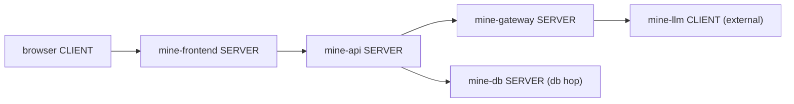

# Workloads

A workload is the request-generating layer of a blueprint. Where constructs emit infrastructure telemetry on a fixed tick, a workload mints correlated request samples per master tick and projects them across traces, logs, and optionally RUM — threading one correlation key-set through every signal class so a trace ID in a span matches the same ID in the application log and the browser beacon.

Three workload kinds are registered:

- **`web_service`** — a single service: a browser→backend→DB hop tree with optional gen_ai/LLM hops, RUM, Beyla, and profiling. Simple and common.
- **`app`** — a blueprint-declared service graph of typed nodes, each with its own custom metrics/logs/spans via the telemetry DSL, and one end-to-end correlated trace across the whole graph. Use when you need multiple backend services each with distinct telemetry, per-service incident targeting, or per-service scaling.
- **`ai_agent`** — coding-agent sessions with correlated turns, model calls, evaluations and optional Sigil generation ingest. The shipped `grafana-ai-o11y` blueprint demonstrates this workload; its complete field surface is in the [generated schema](https://github.com/rknightion/synthkit/blob/main/BLUEPRINT-SCHEMA.md). Sigil uses `GC_SIGIL_*`, separately from OTLP traces and metrics.

These kinds may coexist in one blueprint: model the core correlated flow as an `app`, and simpler peripheral services as standalone `web_service` workloads.

## web_service

`web_service` models a single backend service. One minted request produces:

- A **trace**: optional browser CLIENT root span → backend SERVER span → one CLIENT span per downstream call (database or cache hops, with `db.*` semantic conventions). Traces are backdated so they end at approximately `now`, matching how real spans export on completion.
- **Application logs**: one structured log line per request, correlated by trace/span ID.
- **APM span-metrics**: `traces_spanmetrics_*` histograms + service-graph series on the 60-second metric tick.
- Optional **Faro/RUM beacons** when `rum: true` and `GC_FARO_*` credentials are present.
- Optional **Beyla eBPF** observation lane when `observability.beyla` is set.
- Optional **Pyroscope SDK-push profiles** when `pyroscope:` is set with `mode: sdk`.

Synthetic workload profiles are a customer-data lane: they require a selected workload/profile
declaration plus `GC_PROFILES_URL`, `GC_PROFILES_USER`, and customer `GC_TOKEN`, followed by a fresh
Pyroscope delivery. They are distinct from synthkit **process profiling**, which follows
`SELFOBS_ENABLED` and the separate staff `GC_PYROSCOPE_*` triplet.
- Optional **native OTLP application metrics** (`http.server.*`) when `otel.metrics: true`.

### Key fields

```yaml
workloads:
  - type: web_service
    name: mine-api
    runs_on: mine-prod-use1      # binds to a cluster by its declared name
    tracing: true                # default true; false omits the OTLP lane
    rum: true                    # requires GC_FARO_* creds; omit or false = disabled
    traffic:
      off_peak_rps: 10           # trough request rate (default 5)
      peak_rps: 80               # plateau request rate (default 50)
    endpoints:
      - { route: "GET /v1/search",  error_rate: 0.01, p95_ms: 140 }
      - { route: "POST /v1/items",  error_rate: 0.02, p95_ms: 220 }
    calls:
      - { db: mine-app-db }      # resolved to the named database fixture
      - { cache: mine-sessions } # resolved to the named cache fixture
```

`traffic` drives the **metric lane** volume (span-metrics RPS). The correlation narrative (one request per master tick) is separate and smaller by design — it seeds realistic trace/log samples without inflating span-metric series cardinality.

`endpoints` are drawn uniformly across each minted request; `error_rate` and `p95_ms` shape the per-route latency distribution and error fraction in both spans and span-metrics.

### gen_ai / LLM hops

When a blueprint wires an AI infrastructure construct (AgentCore, Bedrock) to the same cluster, `web_service` emits in-process `gen_ai.*` span attributes and correlated AI logs on the backend span. No additional YAML is needed on the workload; the gen_ai trace vocabulary comes from `internal/genai` (the same seam used by `app`).

## app

`app` declares a **multi-service graph** where each node is a first-class service with its own telemetry. One request minted at the entry node propagates a single correlated trace across the whole graph: every node adds its own SERVER span (and optional CLIENT spans to its downstream calls), so the resulting trace shows the full request journey across all services.

### Service nodes

Each node in `services:` is a `ServiceNode`:

| Field | Description |
|---|---|
| `name` | Unique graph identity; stamped as `service` / `service_name` label on every signal from this node. |
| `type` | Span semantics. Valid values: `frontend` / `web` / `grpc` / `worker` / `job` / `stream` / `gateway` / `db` / `cache` / `llm` / `agent` / `tool` / `workflow` / `retrieval`. Unknown types fall back to a default. |
| `runtime` | `go` / `jvm` / `node` / `python` — selects the catalog runtime profile. |
| `entry` | `true` on exactly one node: the graph's request entry point. |
| `replicas` | Pod count for the k8s substrate cascade (default 2). |
| `calls` | Downstream node names (graph edges). |
| `routes` | Request routes drawn per-request. On the entry node these populate `r.Route`; on a callee they name its SERVER span. |
| `profiles` | Catalog profile template names applied to this node. |
| `metrics` / `logs` / `spans` | Inline custom telemetry via the DSL (the escape hatch). |
| `external` | `true` = remote/managed service: appears as a trace hop but is not deployed as a k8s pod on the caller's cluster. |
| `agentic_flow` | In-process LangGraph orchestration — emits `invoke_workflow` → `invoke_agent` → `execute_tool*` → `chat` span subtree inside this node's SERVER span. |
| `pages` | RUM navigation inventory (frontend entry nodes only). Page-views are RUM-only: they model session navigation around the traced action and emit no backend trace. |

### Service graph example

```yaml
workloads:
  - type: app
    name: mine-app
    runs_on: mine-prod-use1
    traffic:
      off_peak_rps: 5
      peak_rps: 40
      request_latency_p95_ms: 9000   # LLM-call budget; default 200ms suits plain HTTP
    models:
      - { model: gpt-4o,             provider: azure-openai }
      - { model: claude-3-5-sonnet,  provider: bedrock }
    services:
      - name: mine-frontend
        type: frontend
        entry: true
        runtime: node
        replicas: 2
        routes: ["GET /", "GET /search"]
        profiles: [rum_faro, runtime_node]
        calls: [mine-api]

      - name: mine-api
        type: web
        runtime: go
        replicas: 3
        profiles: [scraped_http_server, runtime_go, gen_ai_client]
        calls: [mine-db, mine-gateway]

      - name: mine-gateway
        type: gateway
        runtime: go
        replicas: 2
        profiles: [gateway_export_log]
        calls: [mine-llm]
        external: false

      - name: mine-llm
        type: llm
        external: true              # managed endpoint: trace hop only, no k8s pod
        calls: []

      - name: mine-db
        type: db
        runtime: go
        db_instance: mine-app-db   # links to the RDS fixture for db.* CLIENT span attrs
        calls: []
```

The resulting trace shape:



### Models and gen_ai hops

The top-level `models:` list declares valid (model, provider) pairings. The app minter draws one pair per request and stamps it into the correlation — so `gen_ai.*` span attributes, gateway export logs, and eval log entries all carry the same model and provider for that request. Pairing prevents impossible combinations (e.g. a Claude model on the Azure-OpenAI provider).

An `agentic_flow` on a node adds a nested gen_ai span subtree inside that node's SERVER span:

```yaml
- name: mine-api
  type: web
  runtime: go
  agentic_flow:
    workflow: mine-search-workflow
    agents:
      - name: search-agent
        tools: [vector_search, rerank, summarise]
    omit_chat: false    # false = include the chat <model> leaf (the LLM call)
```

Set `omit_chat: true` when a connected `gateway` or `llm` node already models the LLM call so it is not double-counted.

### Telemetry DSL

Each node can declare custom metrics, log streams, and extra span attributes via inline DSL specs. The DSL is the `profiles:` escape hatch — use catalog profiles first, inline specs for anything not covered.

**Value models** (exactly one per field):

| Kind | YAML | Description |
|---|---|---|
| `const` | `const: 42.0` | Fixed numeric value |
| `const_str` | `const_str: "ok"` | Fixed string |
| `enum` | `enum: [{value: "read", weight: 3}, {value: "write", weight: 1}]` | Weighted categorical draw |
| `int_range` | `int_range: {min: 0, max: 100, p_zero: 0.95}` | Bounded integer; `p_zero` forces 0 with given probability |
| `float_range` | `float_range: {min: 0.001, max: 2.5}` | Bounded float |
| `normal` | `normal: {mean: 50.0, stddev: 10.0}` | Gaussian draw (negative clamped to 0) |
| `bool` | `bool: {p_true: 0.1}` | Weighted boolean |
| `shape` | `shape: {base: 100.0, mode: latency_storm}` | `base × shape-engine reading`; incident-responsive when `mode` is set |
| `ref` | `ref: trace_id` | Pulls a correlation field by name |

**Capability matrix** (enforced at load time):

- **Metric labels** and **Loki stream labels**: only `const` / `const_str` / `enum`. These must enumerate a stable, total domain on every run.
- **Metric values**: only numeric models — `const`, `int_range`, `float_range`, `normal`, `bool`, `shape`.
- **Log body fields** and **span attributes**: any model, including `ref`. High-cardinality correlation keys (`trace_id`, `portkey_trace_id`, `run_id`, etc.) ride here — never as labels or stream labels.

Example inline metric:

```yaml
- name: mine-api
  type: web
  metrics:
    - name: mine_requests_total
      instrument: counter
      labels:
        route:  { enum: [{value: "/search", weight: 3}, {value: "/items", weight: 1}] }
        status: { enum: [{value: "200", weight: 9}, {value: "500", weight: 1}] }
      value:
        shape: { base: 1.0, mode: throughput_drop }
```

### Blueprint-owned custom metrics

Use a service node's `custom_metrics` for blueprint-owned names, reusing the metric DSL above.
Every declaration requires a nonblank `source` citation identifying the instrumentation contract
or documentation for its metric name, unit and label dimensions. The loader checks that a citation
is present, not that its contents are authoritative or its URL is reachable. Citation text stays in
configuration: it is never a metric label, datapoint attribute or OTLP resource attribute. These
names are owned by the blueprint, not additions to the built-in signal catalog.

```yaml
services:
  - name: api
    type: web
    custom_metrics:
      - name: http_requests_total
        source: https://prometheus.io/docs/practices/naming/
        instrument: counter
        labels:
          method: {const_str: GET}
        value: {const: 2} # illustrative fixture: two requests per metric tick, per label combination
      - name: http_request_duration_seconds
        source: https://prometheus.io/docs/practices/histograms/
        instrument: histogram
        unit: s
        labels:
          method: {const_str: GET}
        buckets: [0.5, 1]
        value: {const: 0.75} # illustrative fixture: one 750ms observation per metric tick
```

A counter value is a **per-metric-tick increment**, accumulated across ticks. A histogram value is
one observation per metric tick, accumulated into classic Prometheus `_bucket`, `_sum` and `_count`
series; explicit strictly ascending `buckets` are required. Each label combination receives its own
increment or observation: enum weights do not divide traffic among metric series. Values are not
request-ledger-derived business outcomes; choose tick frequency and value models from the cited
instrumentation and realistic workload volume, rather than treating these fixture values as
production traffic defaults.

Custom metrics always use the existing Prometheus lane. Workload-level `otel.metrics: true` also
mirrors these observations as native cumulative OTLP sums/histograms with stable start times;
node identity becomes resource attributes while declared labels remain datapoint attributes.
With `otel.metrics` omitted or false, no native metrics are emitted. Catalog profiles remain on
the Prometheus lane. Gauges and the rest of the metric DSL are also supported.

Only bounded `const` / `const_str` / `enum` label domains are admitted; high-cardinality keys such
as `trace_id` and high-cardinality `ref` values are rejected even if a key has a constant value.
Node identity keys remain reserved. Put correlation identifiers in log bodies or span attributes,
not metric labels. At workload build, each custom declaration must own a distinct instrument name
and its entire Prometheus family within the service node: a histogram also reserves `_bucket`,
`_sum` and `_count`. Collisions with profiles, legacy `metrics` or other custom declarations are
rejected even when labels are disjoint or units/bounds differ; declarations are never merged.
Existing `metrics` declarations and catalog profiles retain their previous
validation and emission behavior; `custom_metrics` is the additive, citation-required surface.

### Catalog profiles

The catalog ships reusable profile templates that any node can apply by name in `profiles:`:

| Profile | Emits |
|---|---|
| `scraped_http_server` | `http_server_request_duration_seconds` histogram (classic buckets) |
| `runtime_go` | Go runtime metrics: `go_goroutines`, `go_memstats_heap_inuse_bytes`, `process_resident_memory_bytes`, `process_cpu_seconds_total` |
| `runtime_jvm` | JVM metrics: `process_cpu_seconds_total` and GC/heap families |
| `runtime_node` | Node.js runtime metrics: `process_cpu_seconds_total` |
| `runtime_python` | Python runtime: `python_gc_objects_collected_total`, `process_resident_memory_bytes`, `process_cpu_seconds_total` |
| `gen_ai_client` | gen_ai.* client span attributes + correlated AI request log |
| `gateway_export_log` | Portkey gateway export log stream (LLM cost/token/latency fields) |
| `gateway_native_scrape` | Portkey gateway scraped metrics: `request_count`, latency histograms, processing-time families |
| `eval_log` | LangSmith evaluation result log stream |
| `bedrock_invocation_log` | AWS Bedrock model invocation log |
| `rum_faro` | Faro/RUM browser beacon emission (entry frontend nodes only) |

## Failure modes

Workloads register failure modes that incidents can target. See [Incidents](incidents.md) for how to activate them.

**`web_service` modes** (axis: `workload`):

| Mode | Effect |
|---|---|
| `latency_spike` | Elevated request latency (up to 4× at full intensity) |
| `error_burst` | Elevated 5xx error rate |
| `cpu_hotspot` | CPU concentrated in a hot frame (profiling flamegraph) |
| `memory_leak` | Growing heap (profile sample values rise) |
| `lock_contention` | Elevated mutex/block contention (profile values) |
| `goroutine_leak` | Goroutine accumulation (profile values) |

**`app` service-node modes** (axis: `service` — each node is individually addressable):

| Mode | Effect |
|---|---|
| `latency_storm` | Elevated latency on the targeted node |
| `error_spike` | Elevated 5xx rate on the targeted node |
| `throughput_drop` | Reduced throughput on the targeted node |
| `fallback_storm` | Elevated gateway fallback rate on the targeted node |
| `retry_storm` | Elevated gateway retry rate on the targeted node |
| `cpu_hotspot` | Hot frame amplification on the targeted node (profiling) |
| `memory_leak` | Growing heap on the targeted node (profiling) |
| `lock_contention` | Mutex/block contention on the targeted node (profiling) |
| `goroutine_leak` | Goroutine accumulation on the targeted node (profiling) |
| `web_vitals_degraded` | Browser web-vitals degrade on the targeted frontend node — LCP/INP/TTFB/FCP/CLS spike |
